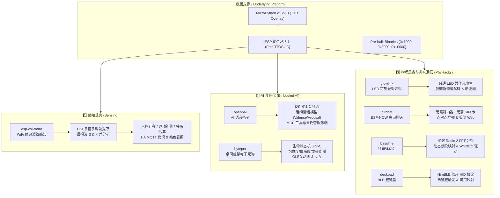

# ⚡ ESP32-内部 · 创意实验室与固件工程矩阵
### ESP32 Internal Lab & Creative Firmware Matrix

[](https://github.com/espressif/esp-idf)
[](https://github.com/micropython/micropython)
[](https://www.espressif.com/)
[](.github/workflows/firmware-ci.yml)
[](LICENSE)

> 本仓库是完全独立解耦的 **ESP32 内部固件与创新实验室工程集合**。
> 涵盖无感感知、具身智能、物理黑客三大主线的 7 个创意项目，以及一套基于 MicroPython v1.27.0 的专用传感器扩展板固件定制层。
> 所有固件均基于 **纯 C / ESP-IDF v5.5.1** 或 **MicroPython 冻结字节码** 构建，杜绝冗余依赖，具备统一的极客暗色交互面板与中英双语工程规范。

---

## 📑 目录 / Table of Contents

- [项目矩阵与概览 / Project Matrix](#-项目矩阵与概览--project-matrix)
- [系统架构与三大主线 / Architecture & Three Themes](#-系统架构与三大主线--architecture--three-themes)
  - [1. 感知现实 (Sensing)](#1-感知现实-sensing)
  - [2. AI 具身化 (Embodied AI)](#2-ai-具身化-embodied-ai)
  - [3. 物理黑客与非凡通信 (PhyHacks)](#3-物理黑客与非凡通信-phyhacks)
- [仓库目录结构 / Repository Structure](#-仓库目录结构--repository-structure)
- [ESP-IDF v5.5.1 环境搭建指南 / ESP-IDF Setup Guide](#-esp-idf-v551-环境搭建指南--esp-idf-setup-guide)
- [一键批量编译 / One-Click Build Script (`build_all.sh`)](#-一键批量编译--one-click-build-script-build_allsh)
- [MicroPython 扩展板固件定制与编译 / MicroPython Firmware Build](#-micropython-扩展板固件定制与编译--micropython-firmware-build)
- [持续集成 / CI & Testing](#-持续集成--ci--testing)
- [硬件连接与通用烧录参数 / Hardware & Flashing Reference](#-硬件连接与通用烧录参数--hardware--flashing-reference)

---

## 📦 项目矩阵与概览 / Project Matrix

| 项目 / Directory | 核心功能 / One-Sentence Pitch | 技术主线 / Theme | 关键技术栈 / Stack | 硬件要求 / Hardware | 状态 / Status |
|---|---|---|---|---|---|
| [**esp-csi-radar**](./esp-csi-radar) | WiFi 隔墙无感人体感知雷达，呼吸与微动检测 | **Sensing** | CSI 原始载波解调 · 自适应基线 · MQTT · WebSocket | 任意标准 ESP32 开发板（无需外接传感器） | ✅ 稳定可用 |
| [**openpal**](./openpal) | 本地优先开源 AI 语音搭子，自托管小智替代方案 | **Embodied AI** | 双工 I2S 音频流 · Valence/Arousal 连续情绪引擎 · MCP 工具调用 | ESP32 + INMP441 + MAX98357A / 浏览器 | ✅ 稳定可用 |
| [**glowlink**](./glowlink) | 普通 LED 兼作收发器的可见光对讲机 | **PhyHacks** | PN 结光电效应 · 曼彻斯特编码/OOK · Web 虚拟示波器 | 2× ESP32 + 普通高亮 LED 模块 | ✅ 稳定可用 |
| [**airchat**](./airchat) | 无网络依赖的 ESP-NOW 离网便携对讲终端 | **PhyHacks** | ESP-NOW 广播 · 节点自组网 · 零配置 Web Chat 控制台 | 任意 ESP32 开发板（2 台或以上） | 🚧 活跃迭代 |
| [**bassline**](./bassline) | 实时音频频谱 Radix-2 FFT 计算与 WS2812 律动灯 | **PhyHacks** | 512点复数 FFT · 对数频段划分 · RMT 驱动 · 霓虹色盘 | ESP32 + 麦克风 (I2S/ADC) + WS2812B 灯带 | 🚧 活跃迭代 |
| [**bytepet**](./bytepet) | 情绪化桌面电子宠物，经典复古养成体验 | **Embodied AI** | 有限状态机 (FSM) · 饥饿/心情/体力模型 · Web 虚拟养成器 | ESP32 + SSD1306 OLED (或 Web 模拟) + 物理按键 | 🚧 活跃迭代 |
| [**deckpad**](./deckpad) | 低延迟 BLE 蓝牙宏按键面板与直播助手 | **PhyHacks** | ESP32 NimBLE HID · 宏组合键映射 · Web 自定义键位编辑器 | ESP32 + 机械轴体矩阵 / 触摸按键 | 🚧 活跃迭代 |
| [**firmware-expansion-board**](./firmware-expansion-board) | 传感器扩展板专用 MicroPython v1.27.0 定制固件 | **Platform** | MicroPython C-module · 冻结 Python 字节码 · TXD 扩展板驱动 | ESP32 传感器多合一扩展板 | ✅ 稳定可用 |

---

## 🧭 系统架构与三大主线 / Architecture & Three Themes



### 1. 感知现实 (Sensing)
- **esp-csi-radar**：利用 WiFi 信号在空间中遇到障碍物与人体反射形成的多径效应，通过监听 52 个 OFDM 子载波的 **信道状态信息 (Channel State Information, CSI)** 计算空间扰动。
  - **核心特性**：零外接传感器、完全本地局域网（保护隐私，无摄像头、无麦克风）、自适应环境基线校准、跌倒与微动触发。
  - **演进路线 (Roadmap)**：从单节点微动检测扩展到双节点空间定位、微弱胸腔起伏呼吸率估计、Matter 协议原生人体存在传感器接入。

### 2. AI 具身化 (Embodied AI)
- **openpal**：极简、本地优先、自托管的智能语音终端系统。
  - **核心特性**：针对 ESP32 算力优化，板端运行精简 I2S 音频编解码与 WebSocket 客户端；服务端提供完整的语音识别 (ASR)、大语言模型 (LLM)、语音合成 (TTS) 与连续情感状态引擎（Valence/Arousal 向量空间，实时影响语音语调与交互表情）。
  - **与商业方案差异**：完全解耦第三方云端绑定，支持 Ollama、DeepSeek、Qwen 等任意兼容 API，支持浏览器免硬件即刻体验。
- **bytepet**：运行在 MCU 上的生命模拟器。具有饱食度、愉悦值、能量和清洁度的完整生理节律状态机，支持通过 Web 端喂食或物理按键抚摸互动。

### 3. 物理黑客与非凡通信 (PhyHacks)
- **glowlink**：利用发光二极管的物理反向特性（LED 的 PN 结在受光照时会产生微弱反向光电流），无需光敏电阻或光电二极管即可完成半双工可见光通信。内嵌 Web 示波器可直接观察光波信号波形。
- **airchat**：利用 ESP32 的底层 WiFi 广播帧（ESP-NOW 协议），在没有路由器、没有蜂窝网络和没有互联网的极端或户外环境下，实现百米级离网文字对讲与自动中继。
- **bassline**：固件级 256/512 点 Radix-2 快速傅里叶变换（FFT），对麦克风输入的音频流按对数听觉特性划分 8/16/32 个频段，驱动 WS2812 幻彩灯带产生流光律动。
- **deckpad**：基于低功耗蓝牙（BLE HID）的多媒体/直播控制器，配合板载 Web 服务器实现按键宏在线编辑与即时保存。

---

## 📂 仓库目录结构 / Repository Structure

```
ESP32-内部/
├── .github/
│   └── workflows/
│       └── firmware-ci.yml        # GitHub Actions 固件构建与自动化测试
├── .gitignore                     # 严格排除 build/、sdkconfig、venv 等编译临时文件
├── README.md                      # 本说明文档 (中英双语架构指南)
├── build_all.sh                   # 根目录一键全固件批量编译脚本
├── binaries/                      # 扩展板出厂固件镜像 (带偏移量命名)
│   ├── bootloader_0x1000.bin
│   ├── partition-table_0x8000.bin
│   ├── micropython_0x10000.bin
│   └── README.md
├── firmware-expansion-board/      # MicroPython 1.27.0 定制传感器层
│   ├── README.md                  # 扩展板固件架构与编译说明
│   ├── build.sh                   # MicroPython 编译与镜像抽取脚本
│   ├── manifest.py                # 固件冻结 Python 模块清单
│   └── overlay/                   # TXD 硬件外设驱动 (OLED/DHT11/PCA9685/超声波等)
│       └── extmod/txd/
├── esp-csi-radar/                 # [Sensing] WiFi 隔墙雷达
│   ├── docs/                      # 架构设计与 CSI 数学原理
│   ├── firmware/                  # ESP-IDF 纯 C 固件 (CMakeLists, main, web)
│   └── tools/                     # WSL2 辅助烧录脚本
├── openpal/                       # [Embodied AI] 本地优先 AI 语音搭子
│   ├── docs/                      # 系统架构、唤醒词与竞品对比
│   ├── firmware/                  # ESP-IDF 音频采集与 WebSocket 传输客户端
│   ├── server/                    # Python FastAPI 服务端 (ASR/LLM/TTS/情绪引擎)
│   └── tools/                     # 服务端启动与本地 demo 脚本
├── glowlink/                      # [PhyHacks] LED 可见光对讲机
│   ├── docs/                      # 光通信协议与硬件电路原理
│   ├── firmware/                  # ESP-IDF 光信号编解码与内置 Web 示波器
│   └── tools/
├── airchat/                       # [PhyHacks] ESP-NOW 离网聊天终端
│   ├── docs/                      # 离网通信架构设计
│   └── firmware/                  # ESP-NOW 广播驱动与离网 Web 控制台
├── bassline/                      # [PhyHacks] 音频频谱 WS2812 律动灯
│   ├── docs/                      # FFT 算法与灯带驱动架构
│   └── firmware/                  # 实时 FFT 计算与 RMT 驱动代码
├── bytepet/                       # [Embodied AI] 桌面电子宠物
│   ├── docs/                      # 状态机机制与互动逻辑
│   └── firmware/                  # 宠物生命节律与像素动画渲染
└── deckpad/                       # [PhyHacks] BLE 蓝牙宏键盘
    ├── docs/                      # 蓝牙 HID 协议与宏映射规范
    └── firmware/                  # NimBLE 键盘驱动与 Web 键位配置器
```

---

## 🛠️ ESP-IDF v5.5.1 环境搭建指南 / ESP-IDF Setup Guide

所有固件均推荐使用 **ESP-IDF v5.5.1**（官方长期推荐工具链）。

### 1. 系统依赖安装 (Ubuntu / Debian / WSL2)

```bash
sudo apt-get update && sudo apt-get install -y --no-install-recommends \
  git wget flex bison gperf python3 python3-pip python3-venv \
  cmake ninja-build ccache libffi-dev libssl-dev dfu-util libusb-1.0-0
```

### 2. 克隆并安装 ESP-IDF v5.5.1

如果当前环境的上级目录已存在 `esp/esp-idf`，可直接复用；若为全新机器，执行以下命令：

```bash
# 创建并进入 esp 目录
mkdir -p ~/esp && cd ~/esp

# 克隆指定 tag 的 ESP-IDF
git clone -b v5.5.1 --recursive https://github.com/espressif/esp-idf.git esp-idf-v5.5.1

# 安装 ESP32 工具链
cd esp-idf-v5.5.1
./install.sh esp32

# 激活环境变量 (建议加入 ~/.bashrc)
source export.sh
```

### 3. 验证安装

```bash
idf.py --version
# 输出应包含: ESP-IDF v5.5.1
```

---

## 🚀 一键批量编译 / One-Click Build Script (`build_all.sh`)

本仓库根目录下提供了全自动批量构建脚本 `build_all.sh`。脚本会自动探测现有环境变量、工作区内置 IDF 或用户主目录工具链。

### 常用命令

```bash
# 1. 批量编译所有 7 个实验室固件
./build_all.sh

# 2. 仅编译指定单个项目 (如 esp-csi-radar)
./build_all.sh esp-csi-radar

# 3. 编译指定的若干个项目
./build_all.sh openpal glowlink

# 4. 清理所有旧构建目录后全量重编
./build_all.sh --clean

# 5. 查看帮助信息
./build_all.sh --help
```

### 单独编译与烧录项目

进入任意项目的 `firmware` 目录即可使用标准 `idf.py` 命令：

```bash
cd esp-csi-radar/firmware

# 设置目标芯片并编译
idf.py set-target esp32
idf.py build

# 连接硬件烧录并开启串口监视 (请替换实际串口)
idf.py -p /dev/ttyUSB0 flash monitor
```

> **WSL2 用户提示**：如果在 Windows 下使用 WSL2，请通过管理员 PowerShell 执行 `usbipd list` 及 `usbipd attach --wsl --busid <BUSID>` 将串口设备映射进 Linux 环境。项目中部分子目录内包含 `tools/flash_wsl.sh` 辅助脚本。

---

## 🐍 MicroPython 扩展板固件定制与编译 / MicroPython Firmware Build

`firmware-expansion-board/` 维护了基于 **MicroPython v1.27.0** 的定制层，内置针对传感器扩展板编写的 C-Module 及 Python 驱动模块（通过冻结字节码 `manifest.py` 编译直接打包进只读固件区，节省运行时 RAM）。

### 内置外设驱动模块 (`overlay/extmod/txd`)

- **OLED 显示器**：`oled` (SSD1306 / SH1106 I2C 屏幕驱动)
- **温湿度传感器**：`DHT11` 单总线驱动
- **超声波测距**：`Ultrasonic` (HC-SR04 定时器测距)
- **土壤湿度**：`SoilMoistureSensor` ADC 模数换算
- **电机与舵机控制器**：`PCA9685` 16 路 I2C PWM 驱动与 `servor` / `motor`
- **RGB 彩灯**：`RGBs` 及板载 LED 驱动

### 编译步骤

```bash
# 1. 确保已导出 ESP-IDF v5.5.1 环境
source ~/esp/esp-idf-v5.5.1/export.sh

# 2. 克隆官方纯净版 MicroPython v1.27.0
git clone --branch v1.27.0 --depth 1 https://github.com/micropython/micropython.git /tmp/micropython

# 3. 调用扩展板构建脚本
MICROPYTHON_DIR="/tmp/micropython" bash firmware-expansion-board/build.sh
```

构建脚本将执行：
1. 拷贝定制层驱动至 `/tmp/micropython/extmod/txd/`。
2. 编译主控交叉编译器 `mpy-cross`。
3. 携带 `manifest.py` 清单编译 ESP32 端口固件。
4. 将生成的镜像输出至 `binaries/generated/`：
   - `bootloader_0x1000.bin` (引导程序，烧录地址 `0x1000`)
   - `partition-table_0x8000.bin` (分区表，烧录地址 `0x8000`)
   - `micropython_0x10000.bin` (应用程序固件，烧录地址 `0x10000`)

---

## 🧪 持续集成 / CI & Testing

仓库配置了 `.github/workflows/firmware-ci.yml`，在每次代码推送和 Pull Request 时自动执行以下校验：

1. **固件编译矩阵 (Matrix Build)**：
   - 基于 `espressif/esp-idf-ci-action@v1` 容器环境。
   - 使用官方 ESP-IDF v5.5.1 并行编译 7 个子工程的 `firmware/`，确保无头编译 100% 通过。
2. **OpenPal 服务端回归测试**：
   - 在 Python 3.12 环境下安装依赖。
   - 执行 `pytest` 自动化单元测试（覆盖情绪引擎演化、MCP 工具分发、算术逻辑）。
   - 启动本地 Mock 服务端并执行 HTTP 端点冒烟验证。

---

## ⚡ 硬件连接与通用烧录参数 / Hardware & Flashing Reference

| 烧录偏移 / Offset | 镜像说明 / Description | 默认文件来源 / File |
|---|---|---|
| `0x1000` | 二级引导程序 (2nd Stage Bootloader) | `binaries/bootloader_0x1000.bin` |
| `0x8000` | 分区表 (Partition Table) | `binaries/partition-table_0x8000.bin` |
| `0x10000` | 应用程序镜像 (App Binary) | `binaries/micropython_0x10000.bin` 或各工程 `build/*.bin` |

使用 `esptool.py` 手动烧录全套镜像示例：

```bash
esptool.py --chip esp32 --port /dev/ttyUSB0 --baud 921600 \
  --before default_reset --after hard_reset write_flash -z \
  --flash_mode dio --flash_freq 40m --flash_size 4MB \
  0x1000 binaries/bootloader_0x1000.bin \
  0x8000 binaries/partition-table_0x8000.bin \
  0x10000 binaries/micropython_0x10000.bin
```

---

## 📄 开源许可证 / License

本项目集合中各子模块保留其专属开源许可证：
- 核心固件与工具脚本遵循 [MIT License](openpal/LICENSE) 或 [Apache-2.0 License](esp-csi-radar/LICENSE)。
- MicroPython 定制层遵循 MIT License 并尊重上游开源协议。
