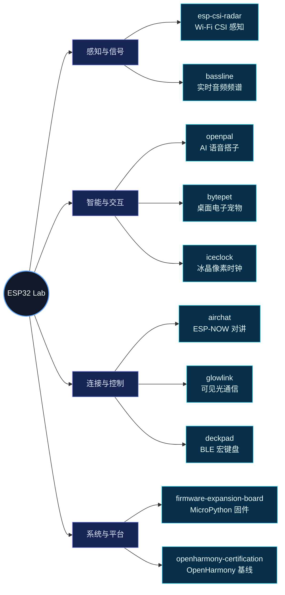
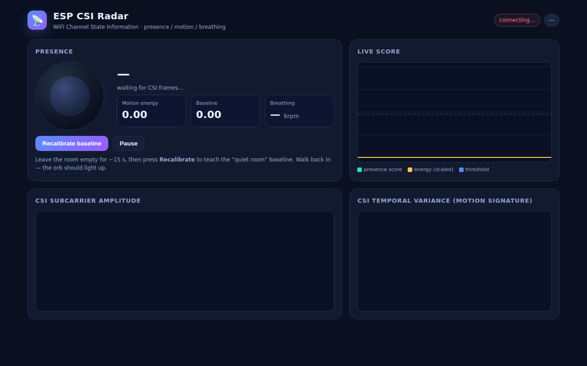
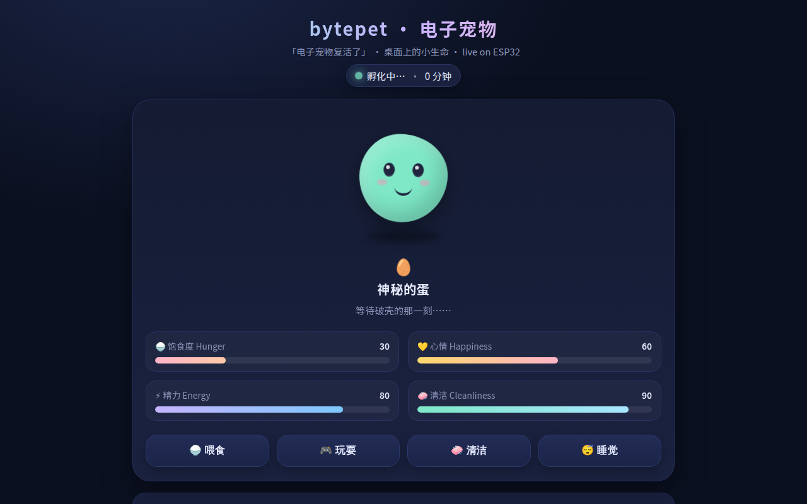
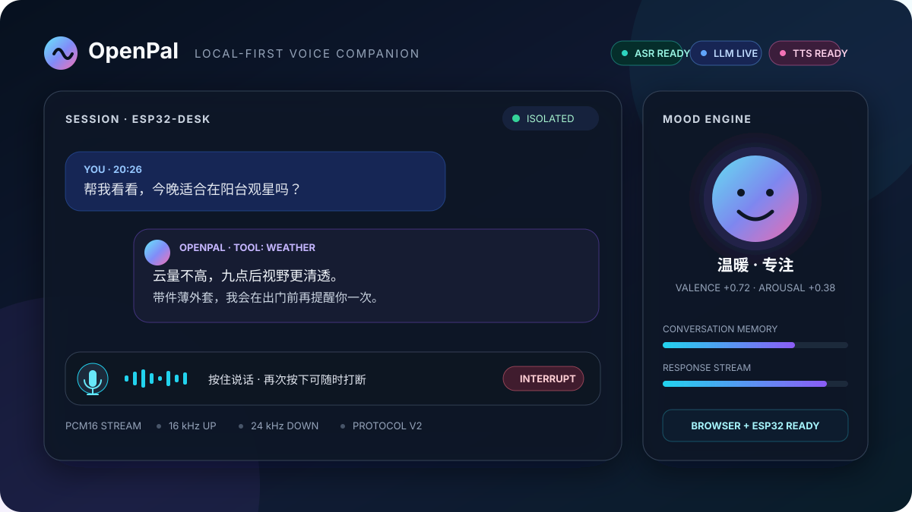
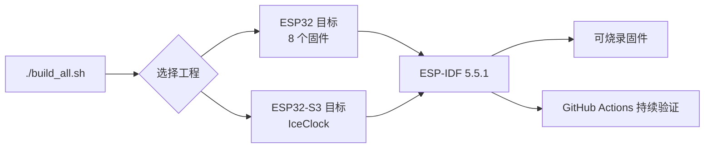

# ⚡ ESP32 Lab

[](https://github.com/espressif/esp-idf)
[](https://github.com/micropython/micropython)
[](https://www.espressif.com/)
[](https://github.com/BUG423/esp32-lab/actions/workflows/firmware-ci.yml)
[](https://creativecommons.org/licenses/by-nc-nd/4.0/)

> **ESP32 Lab** 是面向 ESP32 的创新固件与硬件实验矩阵，聚焦无感感知、具身智能与物理层通信黑客。

---

## 🧭 实验版图



## 📦 创新实验工程矩阵

| 工程 | 方向 | 核心功能与亮点 | 硬件方案 |
|:---|:---:|:---|:---|
| [**esp-csi-radar**](./esp-csi-radar) | 📡 感知 | WiFi CSI 隔墙人体存在感知与微动检测 | 基础 ESP32（无需外接传感器） |
| [**openpal**](./openpal) | 🤖 智能 | 本地优先 AI 语音搭子、流式双向语音与连续情绪引擎 | ESP32 + INMP441 + MAX98357A |
| [**bytepet**](./bytepet) | 🐾 交互 | 桌面虚拟电子宠物与像素动画交互 | ESP32 + SSD1306 OLED / Web |
| [**glowlink**](./glowlink) | 💡 通信 | LED 可见光半双工对讲机 | 2× ESP32 + 普通高亮 LED 模块 |
| [**airchat**](./airchat) | 📻 通信 | ESP-NOW 离网百米级广播对讲终端 | 2× ESP32 开发板 |
| [**bassline**](./bassline) | 🎵 信号 | 实时 FFT 音频频谱计算与 WS2812 律动流光灯 | ESP32 + 麦克风 (I2S/ADC) + WS2812B |
| [**deckpad**](./deckpad) | ⌨️ 控制 | 低延迟 BLE 蓝牙宏键盘与 Web 热键配置 | ESP32 + 机械轴 / 触摸按键 |
| [**iceclock**](./iceclock) | ❄️ 显示 | 冰晶像素风 HUB75 桌面时钟、NTP 校时与 DS3231 断网续时 | ESP32-S3 + HUB75 + DS3231 |
| [**firmware-expansion-board**](./firmware-expansion-board) | 🧩 平台 | 面向传感器扩展板的定制 MicroPython v1.27.0 固件层 | ESP32 + 传感器扩展板 |
| [**openharmony-certification**](./openharmony-certification) | ⚙️ 系统 | OpenHarmony Mini System 兼容性认证、LiteOS-M 调度抽象、SAMGR 服务框架与 HDF 驱动装载 | ESP32-WROOM-32 / NodeMCU-32S + 4MB Flash |

---

## 🖼️ 实验看板与交互预览

| WiFi CSI 隔墙人体感知雷达 (esp-csi-radar) | 桌面虚拟电子宠物状态交互 (bytepet) |
| :---: | :---: |
|  |  |
| **本地优先 AI 流式语音搭子 (openpal)** | **HUB75 冰晶像素桌面时钟 (iceclock)** |
|  |  |

---

## ⚡ 一键构建

仓库根目录提供全自动构建脚本，方便快速验证与固件编译：

```bash
# 一键编译所有实验固件
./build_all.sh

# 编译指定单个项目 (例如 esp-csi-radar)
./build_all.sh esp-csi-radar
```



---

## 📄 知识产权与开源协议

本项目遵循 **[Creative Commons Attribution-NonCommercial-NoDerivatives 4.0 International (CC BY-NC-ND 4.0)](https://creativecommons.org/licenses/by-nc-nd/4.0/)** 严格非商业开源许可：

- ❌ **严禁商用**：任何个人或组织不得将本项目源码、编译产物或衍生版本用于任何商业盈利目的。
- ❌ **禁止演绎与分发修改版**：未经授权不得散布基于本项目修改后的二次分发版本。
- 🔒 **权利保留**：作者保留对本平台代码与架构的所有版权与法律追责权利。
