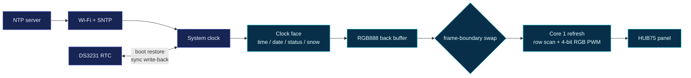
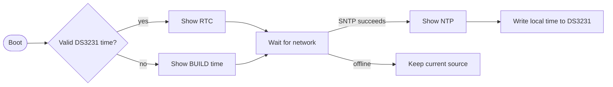

# ❄️ IceClock

[](https://www.espressif.com/en/products/socs/esp32-s3)
[](https://docs.espressif.com/projects/esp-idf/)
[](./docs/architecture.md)
[](./docs/architecture.md)

**An icy pixel-art desk clock for ESP32-S3.** It drives a HUB75 RGB matrix, synchronizes from NTP, and uses a DS3231 to keep useful time while the network is unavailable.

[中文](./README_zh.md) · [Architecture](./docs/architecture.md)


## Architecture at a glance



---

## Features

| Feature | Description |
|---|---|
| HUB75 clock face | 64×32 (1/16 scan) or 64×64 (1/32 scan), 4-bit RGB PWM and tear-free double buffering |
| NTP synchronization | Configurable server and POSIX timezone; resynchronization is handled by ESP-IDF SNTP |
| DS3231 holdover | Restores time at boot and is updated after every successful NTP synchronization |
| Day/night brightness | Automatically switches brightness on a configurable schedule |
| Visible health state | Shows the active time source, Wi-Fi state, and DS3231 die temperature |
| Hourly chime | Optional short pulse for an active buzzer |
| Offline boot | Falls back to the firmware build time when Wi-Fi and RTC time are unavailable |

This release covers the core clock path. Dual-MAX98357 audio, MAX4466 spectrum input, radio/music streaming, image/GIF playback, and resistor-ladder buttons are explicit roadmap items rather than partial or hidden implementations.

---

## Hardware

- Dual-core ESP32-S3 development board with at least 4 MB flash
- 64×32 or 64×64 HUB75 RGB matrix
- DS3231 RTC module (recommended, optional)
- Separate 5 V panel power supply with a shared ground
- 74HCT245 3.3 V-to-5 V level shifter (recommended)
- Active buzzer (optional)

The default breadboard-friendly pin map is fully configurable in `menuconfig`:

| HUB75 | GPIO | HUB75 | GPIO |
|---|---:|---|---:|
| R1 / G1 / B1 | 1 / 2 / 3 | R2 / G2 / B2 | 4 / 5 / 6 |
| A / B / C | 7 / 8 / 9 | D / E | 10 / 11 |
| LAT / OE / CLK | 12 / 13 / 14 | DS3231 SDA / SCL | 15 / 16 |

> HUB75 panels can draw several amps. Do not power the panel from the development board's USB or 5 V pin. The panel supply and ESP32 must share ground.

---

## Quick start

```bash
cd iceclock/firmware
idf.py set-target esp32s3
idf.py menuconfig
idf.py build flash monitor
```

Under `IceClock Configuration`, verify the Wi-Fi/time settings, panel geometry and GPIO map, and DS3231 pins. Leave the SSID empty for offline-only operation.

From the repository root, the batch script selects the ESP32-S3 target automatically:

```bash
./build_all.sh iceclock
```

Display status:

- `NTP`: synchronized during this boot.
- `RTC`: using DS3231 time while waiting for NTP.
- `BUILD`: no valid RTC time; temporarily using firmware build time.
- Green/orange bottom-right pixel: Wi-Fi connected/disconnected.



The temperature shown is the DS3231 die temperature. It is useful for RTC compensation diagnostics, not as a precise ambient-temperature sensor.

---

## Compatibility boundaries

- The portable GPIO refresh driver supports standard, linear-row 1/16- and 1/32-scan HUB75 panels.
- Quarter-scan panels, custom row mappings, and panels requiring FM612x initialization need an additional adapter.
- Refresh is pinned to Core 1, so this firmware targets a dual-core ESP32-S3.
- Pin assignments are not auto-detected; verify them against the board schematic before flashing.

## Roadmap

- [x] HUB75 double buffering and RGB PWM
- [x] NTP-to-DS3231 synchronization
- [x] Scheduled brightness, ice animation, and optional chime
- [ ] Captive-portal provisioning and web face editor
- [ ] MAX98357A I2S audio and spoken chimes
- [ ] MAX4466 spectrum visualization
- [ ] LittleFS GIF/JPG and custom layouts
- [ ] Resistor-ladder button menu

## License

MIT
