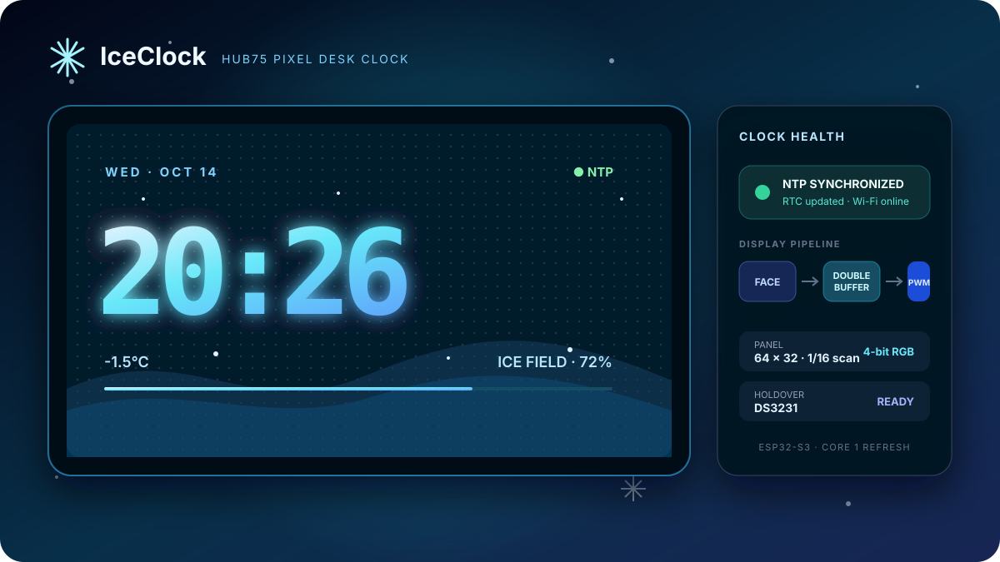
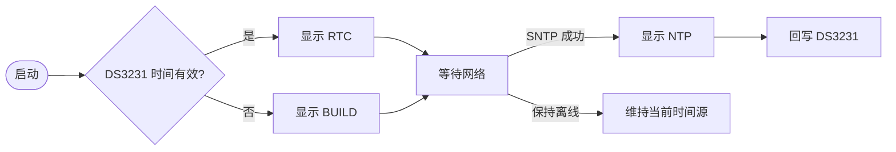

# ❄️ IceClock

[](https://www.espressif.com/zh-hans/products/socs/esp32-s3)
[](https://docs.espressif.com/projects/esp-idf/)
[](./docs/architecture.md)
[](./docs/architecture.md)

**一块会下雪的 ESP32-S3 点阵桌面时钟。** 使用 HUB75 RGB 屏显示冰晶像素表盘，联网后通过 NTP 自动校时，断网时由 DS3231 保持时间。

[English](./README.md) · [架构设计](./docs/architecture.md)



## 架构一览


---

## ✨ 特性

| 功能 | 说明 |
|---|---|
| HUB75 冰晶表盘 | 64×32（1/16 扫）和 64×64（1/32 扫），4-bit RGB PWM、双缓冲防撕裂 |
| NTP 自动校时 | Wi-Fi 接通后同步，可配置 NTP 服务器与 POSIX 时区 |
| DS3231 断网续时 | 启动时从 RTC 恢复时间，NTP 成功后反向校准 RTC |
| 昼夜亮度 | 按时间段自动切换日间/夜间亮度 |
| 状态可见 | 表盘显示 NTP/RTC/固件时间源、Wi-Fi 状态和 DS3231 温度 |
| 整点提示 | 可选有源蜂鸣器整点短鸣 |
| 离线可启动 | 没配 Wi-Fi 或 RTC 缺失时仍能用固件构建时间启动 |

当前版本完成 IceClock 的核心时钟适配。原硬件上可能存在的双 MAX98357 音频、MAX4466 频谱、在线电台、GIF/JPG 和 DAC 按键尚未接入，见下方路线图。

---

## 🧰 硬件

- ESP32-S3 双核开发板，建议 4 MB Flash 或以上
- HUB75 RGB 点阵屏：64×32 或 64×64
- DS3231 RTC 模块（推荐，非必需）
- 5 V 独立屏幕电源及共地连接
- 74HCT245 电平转换（推荐，3.3 V → 5 V）
- 有源蜂鸣器（可选）

默认 GPIO 是便于面包板验证的通用映射，所有引脚均可在 `menuconfig` 中修改：

| HUB75 | GPIO | HUB75 | GPIO |
|---|---:|---|---:|
| R1 / G1 / B1 | 1 / 2 / 3 | R2 / G2 / B2 | 4 / 5 / 6 |
| A / B / C | 7 / 8 / 9 | D / E | 10 / 11 |
| LAT / OE / CLK | 12 / 13 / 14 | DS3231 SDA / SCL | 15 / 16 |

> HUB75 屏的瞬时电流可能达到数安培。不要用 ESP32 开发板的 USB 或 5 V 引脚直接给屏幕供电；屏幕电源与 ESP32 必须共地。

---

## 🚀 快速开始

```bash
cd iceclock/firmware
idf.py set-target esp32s3
idf.py menuconfig
idf.py build flash monitor
```

在 `IceClock Configuration` 中至少确认：

1. `Network and time`：Wi-Fi、NTP 服务器和时区；SSID 留空时进入纯离线模式。
2. `HUB75 panel`：屏幕高度、亮度和实际接线 GPIO。
3. `RTC and alerts`：DS3231 I2C 引脚；需要整点提示时启用有源蜂鸣器。

也可以从仓库根目录构建，脚本会自动为本项目选择 ESP32-S3：

```bash
./build_all.sh iceclock
```

---

## 🖥️ 屏幕状态

- `NTP`：本次启动已完成网络校时。
- `RTC`：尚未网络校时，时间来自 DS3231。
- `BUILD`：RTC 不可用，暂用固件构建时间。
- 右下角绿点：Wi-Fi 在线；橙点：Wi-Fi 离线。



DS3231 的温度来自芯片内部补偿传感器，适合观察 RTC 自身温度，不等同于准确室温。

---

## ⚙️ 兼容边界

- 当前直驱刷新器支持标准连续行映射的 1/16、1/32 扫 HUB75 面板。
- 特殊四扫、行重映射或 FM612x 初始化面板需要新增映射/初始化适配。
- GPIO 刷新任务固定在 Core 1，网络和表盘逻辑运行在另一核心；因此目标限定为双核 ESP32-S3。
- 引脚配置不会自动识别具体 PCB，刷写前必须按原理图核对。

---

## 🗺️ 路线图

- [x] HUB75 双缓冲与 RGB PWM
- [x] NTP → DS3231 自动校准
- [x] 日夜亮度、冰晶动画、整点蜂鸣
- [ ] Captive Portal 配网与网页表盘配置
- [ ] MAX98357A I2S 音频/整点语音
- [ ] MAX4466 频谱可视化
- [ ] LittleFS GIF/JPG 与自定义界面
- [ ] DAC 多按键菜单

## License

MIT
