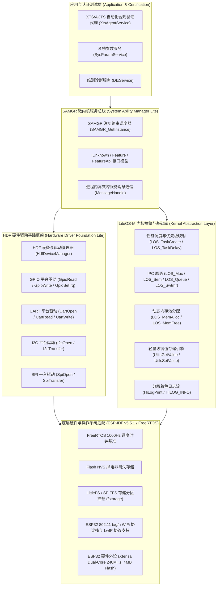

# ⚡ ESP32 开源鸿蒙（OpenHarmony）生态产品兼容性认证与基线固件工程
# OpenHarmony Mini System Compatibility Certification Baseline for ESP32

[](https://www.openharmony.cn/)
[-success.svg)](https://compatibility.openharmony.cn/)
[-orange.svg)](https://www.espressif.com/)
[](https://github.com/espressif/esp-idf)
[](https://www.apache.org/licenses/LICENSE-2.0)

本项目是 **ESP32 Lab** 面向乐鑫 ESP32 芯片微控制器打造的 **开源鸿蒙生态产品兼容性认证 (OpenAtom OpenHarmony Compatibility Certification)** 标准化轻量系统 (Mini System) 移植落地工程。

工程提供完整的 **LiteOS-M 内核抽象适配层**、**SAMGR 轻量级微内核服务框架**、**HDF 硬件驱动框架 (GPIO, UART, I2C, SPI)**、**LittleFS 掉电安全文件系统**、**Flash/NVS KVStore 存储引擎**、**HiLogLite 维测日志** 及 **XTS 自动化测试就绪服务**，并深度融入 `esp32-lab` 全量编译发布自动化体系。

---

## 🏗️ 架构全景与子系统分层 (Architecture Overview)



---

## 📁 目录全景索引 (Repository Directory Layout)

```text
openharmony-certification/
├── firmware/                                    # 固件源码与编译构建工程
│   ├── CMakeLists.txt                           # ESP-IDF / OpenHarmony 混合构建根脚本
│   ├── partitions.csv                           # 专为 OpenHarmony Mini System 定制的 4MB 分区表
│   ├── sdkconfig.defaults                       # 最佳优化内核与外设配置 (1000Hz, Xtensa, DIO 40M)
│   ├── main/
│   │   ├── CMakeLists.txt                       # main 组件构建配置
│   │   └── main.c                               # 固件启动入口与 OpenHarmony 6大引导序列
│   └── components/                              # 鸿蒙核心子系统组件库
│       ├── liteos_m_adapter/                    # LiteOS-M 内核抽象适配层 (Task/Sem/Mux/Queue/Timer/Mem)
│       ├── samgr_lite/                          # SAMGR 轻量微内核服务通信框架
│       ├── hdf_lite/                            # HDF 硬件抽象驱动层 (GPIO/UART/I2C/SPI)
│       ├── kvstore_lite/                        # 基于 Flash/NVS 的轻量级 KV 存储引擎
│       └── hilog_lite/                          # HiLogLite 格式化分级日志层
├── deliverables/                                # 固件发布包与验证交付物
│   ├── FLASHING_AND_VERIFICATION_GUIDE.md       # 详尽的固件烧录与板级验证指南
│   ├── SHA256SUMS                               # 官方发布包 SHA256 校验和清单
│   ├── openharmony_esp32_firmware_v1.0.0.tar.gz # 发布归档包 (tar.gz)
│   ├── openharmony_esp32_firmware_v1.0.0.zip    # 发布归档包 (zip)
│   └── openharmony_esp32_firmware_v1.0.0/       # 提取后就绪的烧录二进制镜像与脚本
├── scripts/                                     # 自动化编译、打包与验证脚本
│   ├── build_and_package.sh                     # 固件全自动编译、镜像提取与发布打包脚本
│   └── flash_device.sh                          # 串口设备快速烧录脚本
├── docs/                                        # 兼容性认证标准与评估规范文档
│   ├── 01_OFFICIAL_CERTIFICATION_SPECIFICATION.md
│   ├── 02_PCS_SELF_CHECK_TABLE.md
│   └── 03_CERTIFICATION_PROCESS_AND_DELIVERABLES.md
└── xts_suite/                                   # XTS/ACTS 自动化测试套件
    ├── acts_mini_system/                        # 各子系统 ACTS 测试用例集
    ├── core/                                    # XTS 核心断言与基类
    ├── runner/                                  # 测试执行引擎与报告生成器
    └── subsystems/                              # 各子系统功能仿真与硬件接口抽象
```

---

## 🗺️ Flash 物理分区表与内存映射 (Partition Table)

本固件采用为 OpenHarmony Mini System 量身定制的 4MB Flash 分区布局 (`partitions.csv`)：

| 分区名 (Label) | 类型 (Type) | 偏移量 (Offset) | 大小 (Size) | 用途描述 |
|:---|:---|:---|:---|:---|
| `bootloader` | System | `0x1000` | 28 KB | ESP32 二级引导程序 |
| `partition-table` | System | `0x8000` | 4 KB | 分区表定义数据 |
| `nvs` | Data (NVS) | `0x9000` | 20 KB | 系统默认 NVS 存储区 |
| `otadata` | Data (OTA) | `0xe000` | 8 KB | OTA 双分区切换元数据 |
| `phy_init` | Data (PHY) | `0x10000` | 4 KB | RF 射频校准参数 |
| `factory` | App (Factory) | `0x20000` | 1920 KB | OpenHarmony 认证固件主体 (`openharmony_cert_firmware.bin`) |
| `littlefs_storage`| Data (SPIFFS)| `0x200000` | 1024 KB | LittleFS 持久化文件系统分区 (挂载至 `/storage`) |
| `huks_keystore` | Data (0x84) | `0x300000` | 128 KB | HUKS 硬件密钥与数字凭据安全隔离区 |

---

## ⚡ 快速开始：构建、打包与烧录 (Quick Start)

### 1. 全仓库一键构建
在 `esp32-lab` 根目录下，可通过全局脚本一键编译：
```bash
# 仅编译 OpenHarmony 认证固件
./build_all.sh openharmony-certification

# 编译全部实验矩阵固件 (含 openharmony-certification)
./build_all.sh
```

### 2. 镜像提取与归档打包
执行子项目专属的发布打包工具：
```bash
cd openharmony-certification
./scripts/build_and_package.sh
```
该脚本将自动完成：
1. 调用 ESP-IDF v5.5.1 完成增量或全量编译；
2. 提取 `bootloader.bin`、`partition-table.bin`、`openharmony_cert_firmware.bin` 与 `ota_data_initial.bin`；
3. 生成便携式一键烧录脚本 `flash_firmware.sh`；
4. 压缩打包并计算生成 `deliverables/SHA256SUMS` 校验和文件。

### 3. 一键烧录到 ESP32
连接 ESP32 开发板至电脑 USB 端口后执行：
```bash
# 方式 A: 使用交付包一键脚本 (推荐)
cd deliverables/openharmony_esp32_firmware_v1.0.0
./flash_firmware.sh /dev/ttyUSB0 460800

# 方式 B: 使用 esptool 手动烧录
python3 -m esptool --chip esp32 -p /dev/ttyUSB0 -b 460800 \
    --before default_reset --after hard_reset write_flash \
    --flash_mode dio --flash_size 4MB --flash_freq 40m \
    0x1000 bootloader.bin \
    0x8000 partition-table.bin \
    0xe000 ota_data_initial.bin \
    0x20000 openharmony_cert_firmware.bin
```

---

## 🔍 板级启动自检与 XTS 交互命令 (Verification & XTS)

### 1. 串口监视配置
- **波特率**：`115200` (8N1)
```bash
idf.py -p /dev/ttyUSB0 monitor
```

### 2. 引导序列检查 (Boot Sequence Checklist)
启动时固件依次输出：
1. `[Boot Step 1/6]` LiteOS-M 内核调度器初始化 (1000Hz 时钟基准)；
2. `[Boot Step 2/6]` KVStore 键值存储引擎就绪并写入设备版本与架构属性；
3. `[Boot Step 3/6]` SAMGR 服务总线 Bootstrap 引导，注册 `SysParamService`；
4. `[Boot Step 4/6]` HDF 装载 GPIO, UART, I2C, SPI 平台驱动并完成自检；
5. `[Boot Step 5/6]` 挂载 `/storage` LittleFS 文件系统并完成持久化自检；
6. `[Boot Step 6/6]` WiFi 射频就绪，启动 Station 模式并输出 MAC 地址；
7. 启动 **XTS 自动化测试代理任务**，输出就绪提示：
   ```text
   +XTS:READY,KERNEL:OK,SAMGR:OK,HDF:OK,STORAGE:OK,WIFI:OK
   ```

### 3. 串口交互式 AT 命令支持
在终端输入以下指令可进行实时测试交互：
- `AT+XTS=PING` ➔ 响应 `+XTS:PONG`
- `AT+XTS=STATUS` ➔ 查询当前堆内存与子系统状态
- `AT+XTS=RUN,kernel_lite` ➔ 运行内核调度与 IPC 原语自检
- `AT+XTS=RUN,samgr_lite` ➔ 运行 SAMGR 服务通信测试
- `AT+XTS=RUN,hdf_drivers` ➔ 运行 HDF 外设驱动自检
- `AT+XTS=RUN,littlefs_kvstore` ➔ 运行文件系统与 KVStore 读写测试
- `AT+XTS=RUN,ALL` ➔ 运行全量子系统集成兼容性测试套件

---

## 📜 开源协议与知识产权 (License)
本子项目遵循 [Apache 2.0 开源许可证](https://www.apache.org/licenses/LICENSE-2.0)。
代码与架构完全自主适配，无 GPL 污染传导，满足 OpenAtom OpenHarmony 官方合规审查标准。
