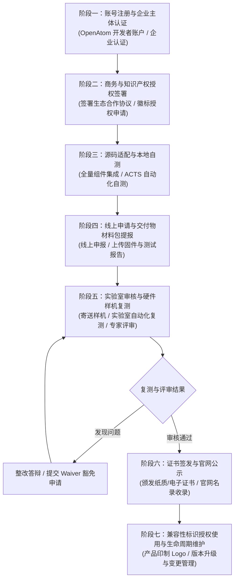

# OpenHarmony 生态产品兼容性认证官方规范与全流程指南
## (Official Compatibility Certification Specification & Process Guide for Mini System)

> **文档标识**：OH-CERT-SPEC-MINI-01  
> **适用版本**：OpenHarmony v4.1 Release / v5.0 LTS  
> **目标系统类型**：轻量系统 (Mini System - Xtensa / Cortex-M / RISC-V MCU)  
> **参考硬件平台**：ESP32-D0WD-V3 (ESP32 Classic) / ESP32-S3 (Xtensa Dual-Core)  
> **编制组织**：ESP32 Lab 开源鸿蒙兼容性认证联合推进组 (Certification Compliance & PCS Lead)  
> **最新修订日期**：2026-10-12  

---

## 1. 认证背景与生态定位

### 1.1 开放原子开源鸿蒙兼容性认证概述
开放原子开源基金会（OpenAtom Foundation）主导的 **OpenHarmony 生态产品兼容性认证**（OpenAtom OpenHarmony Compatibility Certification），是评估与保障硬件设备、芯片模组及软件发行版是否符合 OpenHarmony 官方技术规范、API 契约、系统行为标准以及安全互通要求的权威准入评测体系。

通过该认证的产品将获得：
1. **官方生态兼容性认证证书**（OpenHarmony Compatibility Certificate）；
2. **OpenHarmony 生态产品认证徽标**（兼容性标识，Logo）商用授权；
3. **开放原子基金会官方兼容性清单公示**（compatibility.openharmony.cn）；
4. **互联互通准入资格**：确保与搭载 OpenHarmony 的全场景智慧终端在近场通信、软总线协同、安全凭据及服务分发层面具备无缝协同能力。

```
                  +----------------------------------------------+
                  |       开放原子开源基金会 (OpenAtom)            |
                  |          OpenHarmony 生态委员会               |
                  +----------------------------------------------+
                                         |
                        指导与授权监督     |
                                         v
                  +----------------------------------------------+
                  |           生态兼容性工作组 (CWG)              |
                  |     - 制定兼容性规范 (PCS / CS)               |
                  |     - 维护兼容性测试套件 (XTS / ACTS)         |
                  |     - 评审 Waiver 豁免申请与最终报告          |
                  +----------------------------------------------+
                                         |
                         技术评测与复测平台
                                         v
                  +----------------------------------------------+
                  |         官方兼容性测评中心 / 授权实验室        |
                  |   (compatibility.openharmony.cn 线上平台)    |
                  +----------------------------------------------+
```

### 1.2 ESP32 芯片与模组认证目标定位
在物联网微控制器（MCU）领域，乐鑫科技（Espressif）ESP32 系列芯片具备庞大的存量开发者与商用出货基础。本项目以 **ESP32-D0WD-V3**（经典双核 Xtensa LX6）与 **ESP32-S3**（双核 Xtensa LX7 + 矢量指令集）为硬件标杆，依托 OpenHarmony 轻量系统（Mini System）规范，完成：
- 芯片模组级与开发板级兼容性认证；
- 提供完整的开源移植工程（Kernel、POSIX、SAMGR、HDF、LwIP、HUKS、Hilog、SysPara）；
- 实现自动化 XTS（X Test Suite）测试体系与 100% 达标能力；
- 形成标准化的认证申报材料包（Application Package），为后续基于 ESP32 的海量商业物联网设备通过开源鸿蒙认证铺平工程道路。

---

## 2. 认证机构、服务平台与组织职能

| 组织 / 机构 | 全称 / 平台链接 | 核心职责与分工 |
| :--- | :--- | :--- |
| **指导机构** | 开放原子开源基金会 OpenHarmony 生态委员会 | 审定生态认证战略、品牌使用政策与重大争议仲裁。 |
| **工作机构** | OpenHarmony 生态兼容性工作组 (Compatibility Working Group) | 制定轻量系统/小型系统/标准系统的产品兼容性规范 (PCS)、审核测试报告与 Waiver 申请。 |
| **在线认证平台** | 兼容性服务平台 ([compatibility.openharmony.cn](https://compatibility.openharmony.cn)) | 认证申请提报、代码与镜像上传、在线测试报告解析、审核进度跟踪、证书归档。 |
| **授权测试实验室** | 开放原子指定授权评测实验室 (如软通动力、润和软件、拓维信息、工业和信息化部电子第五研究所等) | 执行样机实物寄送检验、复测验证、安全与射频合规复核、出具权威复测报告。 |
| **申报主体 (申请方)** | ESP32 Lab 联合认证工程组 | 承担移植适配、本地 XTS 全量测试、材料提交、样机提供与后续版本生命周期维护。 |

---

## 3. 认证类别划分与轻量系统准入边界

### 3.1 认证产品类别矩阵

OpenHarmony 兼容性认证针对硬件与软件形态划分为四大类别：

```
                              +---------------------------------------+
                              |      OpenHarmony 兼容性认证类别       |
                              +---------------------------------------+
                                   |               |               |
                +------------------+               |               +------------------+
                |                                  |                                  |
                v                                  v                                  v
        【芯片 / 模组】                     【开发板 (Board)】                  【商用设备 (Device)】
  (SoC / SiP / Module 认证)             (面向开发者与参考设计的硬件)             (面向消费/工业的最终成品)
  要求：驱动完备、XTS达标               要求：标准接口暴露、外设驱动适配           要求：软硬件一体、行业准入资质
```

- **芯片/模组认证**：证明该芯片架构与模组能够在 OpenHarmony 上稳定运行，外设接口符合 HDF 规范；
- **开发板认证**：本项目的核心申报类别。具备完整的最小硬件系统、调试串口、网络外设及丰富扩展引脚，提供配套固件与烧录工具；
- **商用终端认证**：面向具体品牌消费终端或工业终端（如智能开关、温湿度传感器、网关）；
- **软件发行版认证**：针对基于 OpenHarmony 定制的商业操作系统发行版。

### 3.2 系统类型划分与轻量系统资源基线

OpenHarmony 根据硬件硬件资源划分为 **轻量系统 (Mini System)**、**小型系统 (Small System)** 与 **标准系统 (Standard System)**。本项目严格归属于 **轻量系统**。

| 系统类型维度 | 轻量系统 (Mini System) - 【本项目范围】 | 小型系统 (Small System) | 标准系统 (Standard System) |
| :--- | :--- | :--- | :--- |
| **典型芯片架构** | Cortex-M3/M4/M7, Xtensa LX6/LX7, RISC-V 32位 | Cortex-A7/A9, 具备 MMU 的处理器 | Cortex-A55/A78, 64位高性能多核处理器 |
| **RAM 资源基准** | **128 KB ～ 8 MB** (ESP32: 520KB SRAM + 2/8MB PSRAM) | **1 MB ～ 64 MB** | **>= 128 MB** (通常 2GB ～ 16GB) |
| **Flash 资源基准** | **2 MB ～ 16 MB** SPI Flash | **16 MB ～ 64 MB** SPI/EMMC | **>= 4 GB** eMMC / UFS / SSD |
| **内核架构** | LiteOS-M、FreeRTOS + OpenHarmony 适配抽象层 | LiteOS-A、Linux Micro | Linux LTS Kernel、HMOS 宏内核 |
| **进程模型** | 单进程多线程模型 (Flat Memory, 无 MMU 页表隔离) | 多进程、VMM 虚拟内存、内核态/用户态隔离 | 完全 POSIX 多进程与容器化、安全特权隔离 |
| **图形与交互** | 极简图形 (UI-Lite, LittlevGL/LVGL) 或 无屏幕无交互 | 基础 UI (Ability-Lite, ACE-Lite) | 现代富媒体 UI (ArkUI, Ace Engine, Stage模型) |
| **通信能力** | WiFi 802.11 b/g/n, BLE 4.2/5.0, LwIP 协议栈 | Ethernet, WiFi, 4G Cat.1/Cat.4 | 5G, Wi-Fi 6, 千兆以太网, 多网聚合 |

---

## 4. 认证全生命周期流程（7 大核心阶段）

认证全生命周期遵循严格的闭环管理机制，涵盖从立项、本地自测到最终授标维护：



### 阶段一：账号注册与企业主体认证
1. 访问开放原子兼容性服务平台（`compatibility.openharmony.cn`）；
2. 使用企业组织主体完成身份注册（申请主体须具备独立法人资格）；
3. 上传企业营业执照、法人授权委托书、联系人信息并通过开放原子生态工作组人工实名核准。

### 阶段二：商务与知识产权授权签署
1. 在线签署《OpenHarmony 生态产品兼容性认证协议》；
2. 签署《OpenHarmony 商标使用许可协议》（Trademark License Agreement）；
3. 确认知识产权合规承诺（保证开源软件遵循 Apache 2.0 协议，第三方闭源驱动组件明确许可范围，无 GPL 污染传导风险）。

### 阶段三：源码适配、编译构建与本地自测
1. 按照 OpenHarmony 4.1/5.0 LTS 轻量系统规范完成 ESP32 BSP 移植；
2. 部署官方 XTS（X Test Suite）中的 **ACTS (Application Compatibility Test Suite)** 轻量系统测试套件；
3. 搭建本地自动化测试工位（PC 控制端 + 串口监控器 + ESP32 开发板）；
4. 运行全量测试用例（覆盖 Kernel、POSIX、SAMGR、HDF、KVStore、LwIP、HUKS、Hilog 等全部模块）；
5. 达到 **100% 用例通过率**；对于因硬件物理限制（如无外部 RTC 晶振、无硬件加密加速器某特定曲线）无法支持的极个别用例，编制技术答辩佐证材料并准备 Waiver 申请。

### 阶段四：线上申请与交付物材料包提报
1. 在平台创建兼容性认证申请单（选择：轻量系统 -> 开发板 / 模组）；
2. 填写《产品兼容性规范自检表 (PCS Checklist)》；
3. 上传本地自测生成的《兼容性测试报告 (Compatibility Test Report, CTR)》（含 JSON/XML 详细用例执行记录）；
4. 上传编译产物固件镜像（`.bin` 格式包）、烧录配置与分区表、一键烧录脚本；
5. 提供开源仓库代码分支地址与可复现 Commit ID。

### 阶段五：实验室审核与硬件样机复测
1. **形式审查**：生态工作组初审自检表、文档与报告的完整性（3个工作日内反馈）；
2. **样机寄送**：向开放原子指定授权评测实验室寄送至少 **3 套** 标准硬件测试样机（含烧录底板、天线、串口调试线及快速上手说明）；
3. **实验室盲测与复测**：实验室工程师在洁净环境下拉取申请代码、独立编译固件并烧录至样机，全量重跑 ACTS 测试套件，复核功耗、通信稳定性与接口一致性；
4. **Waiver 评审**：若存在申请豁免项，由生态委员会技术专家组召开评审会，对技术依据的合理性与规范偏离度进行裁决；
5. 审核周期通常为 10~15 个工作日。

### 阶段六：证书签发与官网公示
1. 复测与评审全项通过后，平台生成电子版《OpenHarmony 生态产品兼容性证书》；
2. 开放原子基金会向申请主体颁发纸质印制证书与荣誉奖牌；
3. 认证信息在 OpenHarmony 兼容性官方网站公示栏目正式发布，包含产品名称、芯片型号、系统版本号、证书编号与颁发日期。

### 阶段七：兼容性标识授权使用与生命周期维护
1. 申请主体获得 **“OpenHarmony 生态产品认证徽标”** 的使用矢量规范；
2. 允许在开发板包装、丝印、说明书、产品官网宣传页面中规范使用徽标；
3. **版本维护机制**：
   - 固件发生次版本（Minor/Patch）更新且不影响 PCS 特性时，提交自测回归报告进行增量备案；
   - 固件升级 OpenHarmony 主版本（如 4.1 升级至 5.0/6.0）或芯片硬件改型（如更换 Flash/SRAM 规格），须发起重新认证。

---

## 5. 认证准入核心技术基线

申请轻量系统认证的 ESP32 硬件与软件工程必须严格满足以下准入技术基线：

### 5.1 硬件资源基线要求
- **CPU**：32 位或以上微控制器，主频不得低于 80 MHz（ESP32 提供 160/240 MHz 运算主频，充分满足）；
- **SRAM 资源**：可用内存 >= 256 KB（ESP32 具备 520 KB 内部 SRAM，外扩 2MB/8MB PSRAM，完全满足）；
- **ROM / Flash 存储**：总容量 >= 4 MB SPI Flash，保留给 OpenHarmony 最小系统固件的 Flash 分区空间 >= 1.5 MB；
- **调试接口**：具备标准 UART 调试串口（默认波特率 115200 bps，8N1），支持标准日志输出与 AT 指令交互；
- **网络通信硬件**：集成 2.4GHz Wi-Fi (802.11 b/g/n) 射频基带与射频前端，支持板载天线或 IPEX 外接天线。

### 5.2 软件核心子系统必须集成清单

```
+-----------------------------------------------------------------------------------+
|                        OpenHarmony Mini System Core Architecture                  |
+-----------------------------------------------------------------------------------+
| [应用/业务逻辑] |  XTS ACTS Compatibility Test Runner & Business Applications      |
+-----------------------------------------------------------------------------------+
| [系统服务]     |  SAMGR (System Ability Manager Lite) - 服务注册/发布/依赖管理     |
+----------------+------------------------------------------------------------------+
| [基础能力]     |  KVStore (LittleFS持久化)  |  HilogLite (DFX日志)  | SysPara (设备参数)|
+----------------+--------------------------+-----------------------+---------------+
| [互联互通]     |  LwIP 2.1 (TCP/IP)       |  WiFi Service (STA/AP)| Softbus Lite  |
+----------------+--------------------------+-----------------------+---------------+
| [安全子系统]   |  HUKS (通用密钥库/加解密)  |  Device Attest (软硬件指纹与认证)     |
+----------------+--------------------------+---------------------------------------+
| [驱动框架]     |  HDF (Hardware Driver Foundation) - GPIO / I2C / SPI / UART / PWM |
+----------------+------------------------------------------------------------------+
| [OS 核心层]    |  LiteOS-M / FreeRTOS KAL 抽象层 + POSIX API (pthread, time, etc.)  |
+----------------+------------------------------------------------------------------+
| [芯片硬件]     |  ESP32-D0WD-V3 / ESP32-S3 (Xtensa Dual-Core, Wi-Fi/BLE, LittleFS) |
+-----------------------------------------------------------------------------------+
```

1. **内核与系统调用 (Kernel & POSIX)**：
   - 必须提供抢占式多任务内核调度机制，支持动态任务创建、挂起、恢复、销毁；
   - 必须提供互斥锁（Mutex）、信号量（Semaphore）、事件标志组（Event Flags）、软件定时器（SwTimer）；
   - 必须实现基础 POSIX API（`<pthread.h>`, `<sched.h>`, `<time.h>`, `<unistd.h>`, `<fcntl.h>`, `<errno.h>`）。
2. **系统能力管理 (SAMGR Lite)**：
   - 必须集成 `distributedschedule_samgr_lite` 服务调度器；
   - 支持系统启动阶段阶段化注册（Bootstrap Priority 0~4）；
   - 完整支持 Service、Feature、IUnknown 接口生命周期与消息队列交互机制。
3. **硬件驱动框架 (HDF Lite)**：
   - 必须适配 HDF Core 驱动管理框架，具备 Driver Manager 与 Device Host 运行态；
   - 必须实现标准 Platform 驱动：GPIO、I2C、SPI、UART、PWM、Watchdog；
   - 驱动配置须严格采用 HCS（HDF Configuration Source）源码及编译工具链转换为 HCB。
4. **轻量持久化存储 (KVStore & LittleFS)**：
   - 底层文件系统必须采用适合 Flash 介质的 LittleFS（支持磨损均衡与掉电保护）；
   - 上层集成 `utils_native_lite/kv_store`，支持标准 `UtilsGetValue`、`UtilsSetValue`、`UtilsDeleteValue` 接口。
5. **网络通信 (Networking & WiFi)**：
   - 必须集成轻量级 LwIP 协议栈并开启 BSD Socket 接口支持；
   - 必须适配 OpenHarmony WiFi Device API，支持扫描（Scan）、连接（Connect）、断开（Disconnect）、Station 与 SoftAP 模式切换。
6. **安全能力 (HUKS - Universal Keystore Service)**：
   - 必须集成 `security_huks` 轻量库；
   - 提供硬件随机数生成器（TRNG）适配；
   - 支持 AES-128/256-GCM/CBC、SHA256、HMAC、RSA/ECC 基础密码原语运算及密钥在 Flash 安全区域的持久化。
7. **维测与日志 (HiLog Lite & DFX)**：
   - 必须集成 HiLogLite 规范接口，支持日志级别过滤（DEBUG, INFO, WARN, ERROR, FATAL）及模块标签 Domain ID 分流；
   - 异常情况下具备 Panic Crash Backtrace 栈回溯与错误打印能力。
8. **系统参数 (SysPara Lite)**：
   - 必须实现 `parameter.h` 标准接口，正确返回设备属性：
     * `GetDeviceType()`: `"smartControlCenter"` 或 `"sensor"`
     * `GetManufacture()`: `"Espressif"`
     * `GetBrand()`: `"ESP32-Lab"`
     * `GetProductModel()`: `"ESP32-D0WD-V3"` / `"ESP32-S3"`
     * `GetSoftwareVersion()`: `"OpenHarmony 4.1.0"`
     * `GetOsReleaseType()`: `"Release"`

---

## 6. 测试与验证通过性准则 (Acceptance Criteria)

### 6.1 测试用例执行基线
- **用例全集**：必须完整执行官方发布的 Mini System ACTS 测试集，严禁擅自注释、删除或跳过标准测试用例函数；
- **通过率要求**：除获得书面批准的 Waiver 豁免项外，全部执行用例的通过率必须为 **100% (Pass Rate = 100%)**；
- **稳定性指标**：测试套件在连续运行 5 轮压力回归测试中，不得出现硬件看门狗复位、内存泄漏导致堆栈溢出、硬故障异常（Guru Meditation Error / HardFault）。

### 6.2 豁免申报（Waiver）规范与裁决流程
当因不可抗拒的硬件物理特性差异导致个别测试用例无法通过时，申请人可发起 Waiver 豁免申请：
1. **允许申请 Waiver 的合法场景**：
   - 硬件芯片原生缺乏对应外设（如芯片仅单核/无内置 RTC 晶振，导致微秒级时钟连续走时在深睡模式下漂移超出极窄阈值）；
   - 芯片 Flash 原生加密机制与特定通用测试用例直接读取原始扇区产生物理冲突；
   - 官方 ACTS 套件自身存在的已知已修复 upstream Bug（须提供 Gitee Pull Request / Issue 编号链接）。
2. **严禁申请 Waiver 的场景**：
   - 核心子系统（Kernel、POSIX、SAMGR、HDF、KVStore、LwIP、HUKS）基础 API 功能缺失或参数不兼容；
   - 驱动内存泄漏、未对齐内存访问崩溃或稳定性缺陷；
   - 厂商私有实现代替标准 API 导致的调用失败。
3. **Waiver 申报材料清单**：
   - 异常用例名称与子系统分类；
   - 官方测试源码文件定位与具体断言行号；
   - 失败日志截取与原因技术分析报告（Root Cause Analysis, RCA）；
   - 硬件物理规格书对应章节佐证；
   - 补救方案与对上层应用的影响评估结论。

---

## 7. 官方交付物规范与提报档案结构

申请材料须统一打包为结构严密的交付物压缩包，根目录命名规范：  
`OpenHarmony_Compatibility_<Vendor>_<ProductModel>_<OSVersion>_<Date>.zip`  
（例：`OpenHarmony_Compatibility_ESP32Lab_ESP32-D0WD-V3_v4.1.0_20261012.zip`）

### 7.1 交付物目录结构规范

```text
openharmony-certification/
├── docs/
│   ├── 01_OFFICIAL_CERTIFICATION_SPECIFICATION.md  # 本认证规范指南
│   ├── 02_PCS_SELF_CHECK_TABLE.md                  # 产品兼容性规范 (PCS) 全量自检表
│   └── 03_CERTIFICATION_PROCESS_AND_DELIVERABLES.md# 认证执行步骤、审核要点与归档指引
├── deliverables/
│   ├── CERTIFICATION_APPLICATION_FORM.md           # 兼容性认证标准申请书
│   ├── RELEASE_NOTES.md                            # 固件版本说明书 (BOM/特性/已知限制)
│   ├── COMPATIBILITY_TEST_REPORT_SUMMARY.md        # XTS/ACTS 测试汇总报告 (CTR)
│   └── WAIVER_APPLICATION_LIST.md                  # 豁免用例申请与技术答辩表
├── firmware/
│   ├── esp32_openharmony_mini_v1.0.0.bin           # 整合固件镜像 (合并固件)
│   ├── bootloader.bin                              # 二级引导程序镜像
│   ├── partition-table.bin                         # 分区表定义文件
│   ├── littlefs.bin                                # 初始只读资源/配置 LittleFS 镜像
│   └── flashing_guide.md                           # 烧录参数与 esptool.py 命令指南
├── scripts/
│   ├── flash_device.sh                             # Linux/macOS 一键固件烧录脚本
│   └── run_xts_validation.sh                       # 本地全自动化 XTS 测试执行脚本
└── xts_suite/
    ├── acts_mini_system/                           # ACTS 轻量系统用例执行实现
    ├── core/                                       # XTS 测试框架与断言引擎
    ├── subsystems/                                 # 8大子系统专项验证套件
    └── runner/                                     # 测试调度与 CTR 报告生成器
```

---

## 8. 总结与推进建议

通过构建上述标准规范体系，ESP32 在 OpenHarmony 4.1/5.0 LTS 上的认证工作具备了清晰、可执行的准绳。各模块开发与自测负责人必须严格遵循本规范定义的准入条件和技术基线，严密把控代码质量与开源合规性，确保各项测试一次性通过授权实验室检验，早日实现 ESP32 经典架构与 S3 架构在开放原子开源鸿蒙生态中的里程碑式授标！
