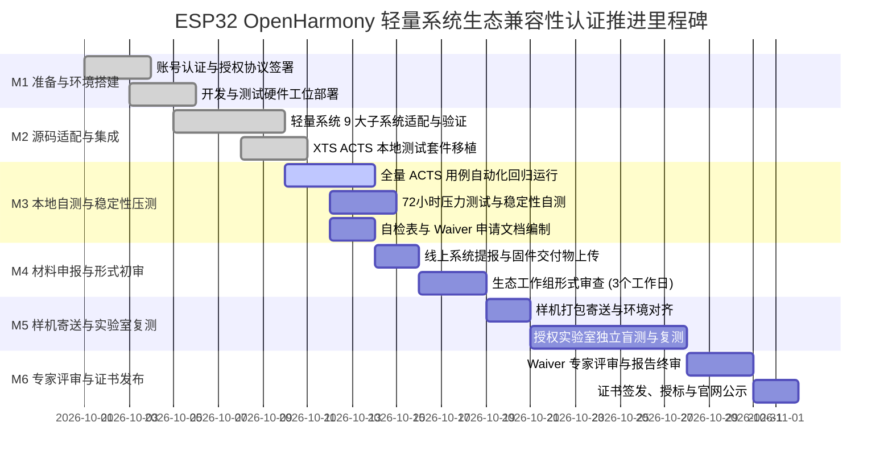
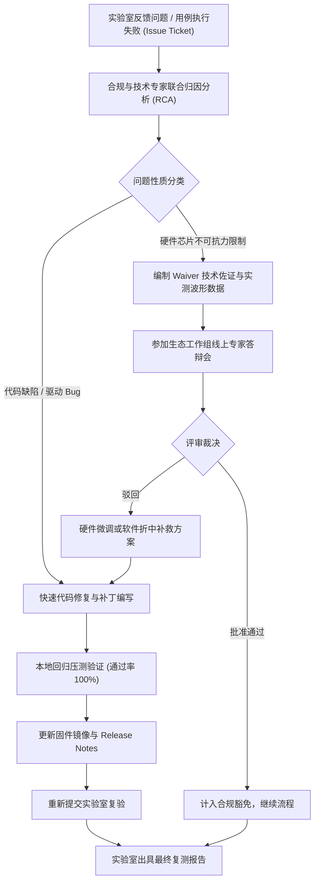

# OpenHarmony 生态产品兼容性认证执行步骤、审核要点与交付物归档指引
## (Certification Execution Steps, Audit Checkpoints & Deliverables Archival Guide)

> **文档标识**：OH-CERT-PROC-MINI-03  
> **适用范围**：ESP32-D0WD-V3 / ESP32-S3 轻量系统认证实施全周期  
> **制定部门**：ESP32 Lab 认证合规与质量保障工作组  
> **执行标准**：OpenHarmony 4.1 Release / 5.0 LTS 兼容性测试与认证管理办法  
> **最新修订日期**：2026-10-12  

---

## 1. 目的与使用范围

本文档作为 ESP32 开源鸿蒙（OpenHarmony）轻量系统功能认证落地的实操指南，旨在规范项目从前期筹备、代码适配、本地 XTS/ACTS 自测、材料申报、官方实验室复测到最终获颁证书的全生命周期执行标准。明确各项关键审核要点、技术红线及交付物打包归档规范，指导工程研发、测试与合规申报人员高效推进。

---

## 2. 认证执行工作流与里程碑计划 (Milestone Schedule)

整体认证周期划分为 6 个里程碑阶段（通常历时 4~6 周）：



### 里程碑交付物与准出条件判定

| 里程碑 | 核心任务 | 准出条件 (Exit Criteria) | 责任角色 |
| :--- | :--- | :--- | :--- |
| **M1: 准备阶段** | 完成基金会注册、签署协议、采购测试样机底板与转接工具。 | 企业实名认证通过，商务授权合同签署完成。 | 认证商务负责人 |
| **M2: 适配阶段** | 完成 ESP32 FreeRTOS/LiteOS-M KAL、HDF 驱动与通信层集成。 | 源码可平滑编译，最小系统正常引导进入命令行。 | 固件 BSP 负责人 |
| **M3: 自测阶段** | 运行 ACTS 全量测试用例，记录测试日志，形成 CTR 原始数据。 | 用例通过率 100%（或完成 Waiver 技术答辩编制）。 | XTS 测试负责人 |
| **M4: 申报阶段** | 提报在线申请单，上传自检表、CTR 报告、固件与烧录说明。 | 官方平台初审受理无驳回，获得申请流水号。 | 合规申报专家 (PCS Lead) |
| **M5: 复测阶段** | 寄送 3 套开发板样机，配合官方实验室完成盲测与交叉验证。 | 实验室复测通过，出具正式盖章复测报告。 | 质量测试组 + 实验室工程师 |
| **M6: 获标阶段** | 参与生态委员会技术评审会，领取证书与徽标授权使用指南。 | 官网兼容性清单公示，获得电子/纸质认证证书。 | 项目总负责人 |

---

## 3. 官方审核关键要点与技术红线 (Audit Checkpoints & Red Lines)

在官方形式审查、代码合规审查及实验室复测中，必须严密防范以下技术红线，确保一次性通过。

### 3.1 形式审查要点 (Format & Administrative Audit)
1. **产品命名规范性**：产品名称严禁使用侵权词汇；申请芯片型号（`ESP32-D0WD-V3`）必须与硬件丝印、eFuse 寄存器值完全对应；
2. **版本一致性（三位一体校验）**：
   - 申请书填报的软件版本（如 `OpenHarmony 4.1.0`）；
   - 代码中 `GetSoftwareVersion()` 系统参数返回的字符串；
   - 提交编译固件的 Release Notes 声明版本；
   - **红线**：三者中任何一处存在版本号不匹配，形式审查直接驳回。
3. **交付物完整性**：自检表不得存在空填、漏填项，每一项必须具备技术实现依据；测试报告必须包含所有测试用例的耗时与执行记录。

### 3.2 源码与开源合规审查要点 (Open Source Compliance Audit)
1. **开源许可证清洁度**：
   - OpenHarmony 核心框架代码遵循 **Apache License 2.0**；
   - ESP-IDF 适配层及驱动层代码遵循 **Apache 2.0** 或 **BSD-3-Clause**；
   - **绝对红线**：严禁在内核、系统服务及公用驱动中引入 **GPL / AGPL** 开源组件，严禁导致传染性开源许可证风险；
2. **代码提交规范与无侵权**：
   - 移植代码必须通过静态代码审查（Checkstyle / C Linter），无安全高危漏洞（如缓冲区溢出、硬编码敏感密码、未校验的指针访问）；
   - 提交 Gitee/GitHub 仓库的代码需具备清晰的 Commit History，无未授权的反编译闭源二进制引入。

### 3.3 接口契约与功能审查要点 (Interface Contract Audit)
1. **API 原生性契约**：不得为了规避测试报错而修改 OpenHarmony 官方提供的 XTS 测试用例源代码；
2. **标准接口完整性**：
   - POSIX 基础系统调用、SAMGR 服务发布机制、HDF Platform 驱动抽象层严禁提供私有打桩假实现（Stub）；
   - 硬件返回状态必须与真实物理状态完全一致（例如：GPIO 实际拉高拉低、I2C 物理波形可测量、Flash 真正完成扇区擦写）。

### 3.4 样机物理与稳定性复测要点 (Physical & Stability Audit)
1. **冷热启动自愈性**：
   - 开发板在执行 100 次冷上电（Power-Cycle Reset）与 100 次软件重启（Software Reboot）后，系统必须 100% 正常引导至 Ready 状态，无死锁或 Boot Loop；
2. **掉电抗损能力**：
   - 在向 LittleFS / KVStore 持续高频写入大文件的过程中强制突发切断电源，重新上电后文件系统必须具备自检自愈能力，严禁出现文件系统挂载失败；
3. **内存无泄漏与长期稳态**：
   - XTS 测试套件连续运行 24 小时循环压测，系统可用空闲堆内存（Free Heap）在每轮测试结束后必须回归初始稳态水位，内存泄漏量必须为 0。

---

## 4. 全量交付物清单与规格规范 (Deliverables Inventory)

向开放原子兼容性平台提报的完整材料包涵盖以下 5 大类别：

```
+-----------------------------------------------------------------------------------------------+
|                       OpenHarmony 兼容性认证全量交付物矩阵                                      |
+-------------------+---------------------------------------------+-----------------------------+
| 交付物类别        | 具体文件 / 实体                             | 格式与规格要求              |
+-------------------+---------------------------------------------+-----------------------------+
| 类别 1: 规范文档  | 1.1 认证申请书 (Application Form)           | Markdown / PDF (盖章扫描件) |
|                   | 1.2 PCS 规范自检表 (PCS Checklist)          | Markdown / Excel 标准模板   |
|                   | 1.3 版本说明书 (Release Notes)              | Markdown / PDF              |
|                   | 1.4 架构设计与移植说明 (Porting Guide)       | Markdown                    |
+-------------------+---------------------------------------------+-----------------------------+
| 类别 2: 测试数据  | 2.1 兼容性测试汇总报告 (CTR Summary)         | Markdown / PDF              |
|                   | 2.2 XTS 全量用例执行原生日志 (CTR Raw Log)   | JSON / XML / Console Text   |
|                   | 2.3 豁免申请与答辩表 (Waiver Report)        | Markdown / PDF              |
+-------------------+---------------------------------------------+-----------------------------+
| 类别 3: 固件介质  | 3.1 完整固件镜像 (Firmware Binaries)        | .bin 二进制 (可一键烧录)     |
|                   | 3.2 固件分区表 (Partition Table)            | .csv / .bin                 |
|                   | 3.3 烧录指南与工具脚本 (Flashing Guide)      | Shell Script (.sh) / .md    |
+-------------------+---------------------------------------------+-----------------------------+
| 类别 4: 开源软件  | 4.1 开源 Git 仓库与 Commit Tag 链接         | 包含 LICENSE 与 NOTICE      |
|                   | 4.2 离线源码归档包 (Source Code Archive)    | .tar.gz (支持一键构建)      |
+-------------------+---------------------------------------------+-----------------------------+
| 类别 5: 实体硬件  | 5.1 ESP32 开发板测试样机 (至少 3 套)        | 包含核心板、底板、天线      |
|                   | 5.2 串口调试线与 Micro-USB 供电线           | 标配连接线缆                |
|                   | 5.3 硬件接线与快速上手说明卡                | 纸质打印卡片                |
+-------------------+---------------------------------------------+-----------------------------+
```

---

## 5. 交付物归档目录规范与打包验证指令

交付物在提报前须统一进行标准化归档与校验，确保任何第三方实验室拿到材料包后均能无歧义复现。

### 5.1 本地工程交付物归档目录结构

```text
openharmony-certification/
├── docs/
│   ├── 01_OFFICIAL_CERTIFICATION_SPECIFICATION.md      # 官方认证规范与全流程指南
│   ├── 02_PCS_SELF_CHECK_TABLE.md                      # PCS 产品兼容性全量自检表
│   └── 03_CERTIFICATION_PROCESS_AND_DELIVERABLES.md    # 认证执行步骤与交付物归档指引
├── deliverables/
│   ├── CERTIFICATION_APPLICATION_FORM.md               # 官方生态产品兼容性认证申请书
│   ├── RELEASE_NOTES.md                                # 固件版本说明书 (Release Notes)
│   ├── COMPATIBILITY_TEST_REPORT_SUMMARY.md            # XTS/ACTS 兼容性测试汇总报告 (CTR)
│   └── WAIVER_APPLICATION_LIST.md                      # 豁免用例申请与技术答辩表
├── firmware/
│   ├── esp32_openharmony_mini_v1.0.0.bin               # 合并后的全量可烧录镜像 (0x0 起始)
│   ├── bootloader.bin                                  # 二级 Bootloader 引导镜像 (0x1000)
│   ├── partition-table.bin                             # 芯片 Flash 分区表 (0x8000)
│   ├── littlefs.bin                                    # 初始只读资源文件系统镜像
│   └── flashing_guide.md                               # 烧录参数与 esptool 命令指引
├── scripts/
│   ├── flash_device.sh                                 # 一键多平台烧录 Shell 脚本
│   └── run_xts_validation.sh                           # 本地全自动化 XTS 测试执行脚本
└── xts_suite/                                          # ACTS 自动化测试套件与执行引擎
```

### 5.2 打包与哈希完整性校验指令

在提报前，必须在 Linux 构建机终端执行以下标准归档打包命令，并生成全局校验清单（Checksum）：

```bash
#!/bin/bash
# 进入认证工程目录
cd /home/zss/workspace/repo_governance_work/repos/esp32-lab/openharmony-certification

# 设定归档版本与名称
PACKAGE_NAME="OpenHarmony_Compatibility_ESP32Lab_ESP32-D0WD-V3_v4.1.0_$(date +%Y%m%d)"
ARCHIVE_DIR="../${PACKAGE_NAME}"

# 1. 复制所有交付物到洁净目录
mkdir -p "${ARCHIVE_DIR}"
cp -r docs deliverables firmware scripts xts_suite "${ARCHIVE_DIR}/"

# 2. 生成固件与交付物的 SHA-256 校验和文件
cd "${ARCHIVE_DIR}"
find . -type f ! -name "CHECKSUM_SHA256.txt" -exec sha256sum {} + > CHECKSUM_SHA256.txt

# 3. 压缩归档打包
cd ..
zip -r "${PACKAGE_NAME}.zip" "${PACKAGE_NAME}"
tar -czvf "${PACKAGE_NAME}.tar.gz" "${PACKAGE_NAME}"

# 4. 输出最终归档信息
echo "======================================================="
echo "OpenHarmony Certification Package Generated Successfully:"
echo "Archive File: ${PACKAGE_NAME}.zip"
sha256sum "${PACKAGE_NAME}.zip"
echo "======================================================="
```

---

## 6. 认证答辩、整改与跟踪机制 (Remediation Protocol)

在官方实验室复测过程中，若出现用例未通过或专家提出异议，必须严格遵循闭环跟踪机制：



1. **响应时效契约**：收到官方实验室问题单（Ticket）后，项目组必须在 **24 小时内** 完成初步技术确认并响应；
2. **修复闭环窗口**：普通代码缺陷须在 **3 个工作日内** 完成修复、回归自测并更新提报物；
3. **专家答辩准备**：针对涉及 Waiver 或系统规范理解分歧的事项，PCS Lead 须准备包含寄存器时序、示波器抓包截图、业界同类芯片对比材料的独立答辩幻灯片，在每周生态委员会工作例会上进行技术答辩。
