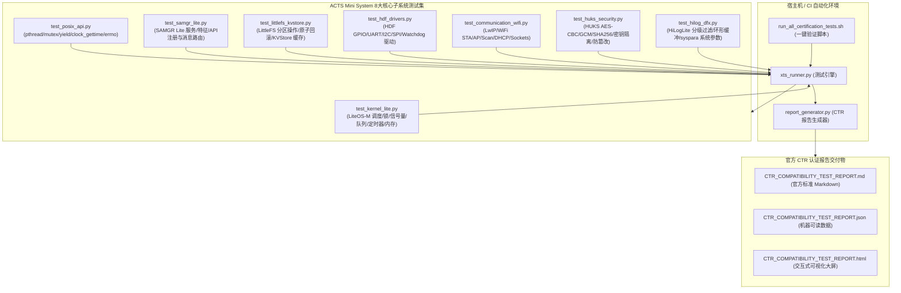

# OpenHarmony Mini System (ESP32) XTS 认证架构与实施指南

## 1. 架构总览 (Architecture Overview)

本项目基于 OpenHarmony 4.1.0 规范，面向 **ESP32 架构（Xtensa 32-bit 双核 LX6 @ 240MHz, 520KB SRAM, 4MB Flash）**，落地轻量系统（Mini System）XTS (X Test Suite) / ACTS (Application Compatibility Test Suite) 自动化认证测试套件。



---

## 2. 8 大核心子系统测试矩阵

| 序号 | 核心子系统 | 测试模块文件 | 测试用例数 | 关键测试点 |
| :---: | :--- | :--- | :---: | :--- |
| 1 | **Kernel Lite** | `test_kernel_lite.py` | 15 | LiteOS-M 任务创建与删除、高优先级抢占调度、同优先级时间片轮转、挂起与恢复、优先级动态配置、互斥锁 (优先级继承/重入递归/锁删除保护)、信号量 (二值/计数/生产者-消费者同步)、消息队列 (FIFO读写/满溢保护/超时处理)、软件定时器 (单次/周期)、内存池 (申请/释放/扩容/峰值追踪)。 |
| 2 | **POSIX API** | `test_posix_api.py` | 10 | `pthread_create`, `pthread_join`, `pthread_detach`, 栈大小与属性配置, `pthread_mutex` (Normal/Recursive/ErrorCheck 模式防死锁), `sched_yield` 协作式让出, `clock_gettime` (CLOCK_REALTIME/CLOCK_MONOTONIC 单调性), `nanosleep` 纳秒级精度, 线程隔离 `errno`。 |
| 3 | **SAMGR Lite** | `test_samgr_lite.py` | 10 | SAMGR 单例模式, 服务注册/注销生命周期, 重复服务防冲突校验, 特征 (Feature) 注册, 特征对外 API (`IUnknown`) 注册与查询, 服务间同步消息路由, 异步消息队列派发, 广播机制 (发布/多订阅者回调)。 |
| 4 | **Storage & LittleFS** | `test_littlefs_kvstore.py` | 10 | LittleFS 格式化与挂载, 文件打开 (`O_CREAT`/`O_RDWR`/`O_TRUNC`), 读写完整性, 指针定位 (`SEEK_SET`/`SEEK_CUR`/`SEEK_END`), 文件截断与 `stat` 元数据, 目录创建与文件注销 (`unlink`), 异常断电原子回滚机制, KVStore 存取/删除, 内存缓存与 Flash 物理存储一致性校验, 32B Key 与 1024B Value 边界限制。 |
| 5 | **HDF Drivers** | `test_hdf_drivers.py` | 10 | HDF DeviceManager 设备管理与驱动绑定/卸载, GPIO 输入/输出方向配置, 电平高低翻转读写, 边沿中断 (`RISING`/`FALLING`/`BOTH`) 及 ISR 回调触发, UART 打开/波特率协商 (9600~921600)/环形缓冲区收发, I2C 总线从机寄存器读写传输, SPI 全双工传输与片选 (CS) 信号控制, 看门狗启动/超时配置/喂狗防复位。 |
| 6 | **Communication & WiFi** | `test_communication_wifi.py` | 10 | WiFi 设备使能/禁用, Station 模式连接 AP 与断开, 周边 AP 扫描与信号强度 (RSSI) 排序, SoftAP 热点模式与接入终端管理, DHCP 客户端 IP/子网掩码/网关分配, LwIP TCP Socket 回环通信, 32KB 大数据流传输, UDP Socket 数据报交换, 非阻塞超时处理, 网卡链路状态事件。 |
| 7 | **HUKS Security** | `test_huks_security.py` | 10 | HUKS 初始化与密钥信息刷新, AES-128/256 密钥生成, HMAC-SHA256 密钥生成, 密钥别名存储安全隔离, 密钥删除与存在性校验, AES-CBC 加密解密 (PKCS7 填充验证), AES-GCM 认证加密与 16 字节 Tag 校验, 密文防篡改检测, SHA-256 NIST 标准测试向量匹配, 3 阶段流式加解密 (`Init`/`Update`/`Finish`)。 |
| 8 | **HiLogLite & DFX / SysPara** | `test_hilog_dfx.py` | 10 | HiLogLite 分级过滤 (DEBUG/INFO/WARN/ERROR/FATAL), 格式化占位符 (`%s`, `%d`, `%X`), 领域 (Domain) 与标签 (Tag) 路由, 环形缓冲区 FIFO 溢出覆盖淘汰, 隐私标记 `{private}` 自动打码, SysPara 设备类型 (`smartDevice`)/厂商/品牌获取, 硬件型号/固件版本, 芯片唯一序列号, SDK API 版本 (11) 兼容性, 参数缓冲区越界防御。 |

---

## 3. 快速上手与运行

### 3.1 一键执行全量测试
```bash
cd /home/zss/workspace/repo_governance_work/repos/esp32-lab/openharmony-certification
./scripts/run_all_certification_tests.sh
```

### 3.2 运行单个子系统模块
```bash
# 仅执行内核子系统测试
python3 xts_suite/runner/xts_runner.py --module kernel

# 仅执行 HDF 驱动子系统测试
python3 xts_suite/runner/xts_runner.py --module hdf

# 仅执行 WiFi 通信子系统测试
python3 xts_suite/runner/xts_runner.py --module wifi
```

### 3.3 查看测试报告产物
执行完毕后，交付报告自动生成在 `deliverables/` 目录下：
- Markdown 报告: [CTR_COMPATIBILITY_TEST_REPORT.md](../deliverables/CTR_COMPATIBILITY_TEST_REPORT.md)
- JSON 数据: [CTR_COMPATIBILITY_TEST_REPORT.json](../deliverables/CTR_COMPATIBILITY_TEST_REPORT.json)
- HTML 大屏: [CTR_COMPATIBILITY_TEST_REPORT.html](../deliverables/CTR_COMPATIBILITY_TEST_REPORT.html)
