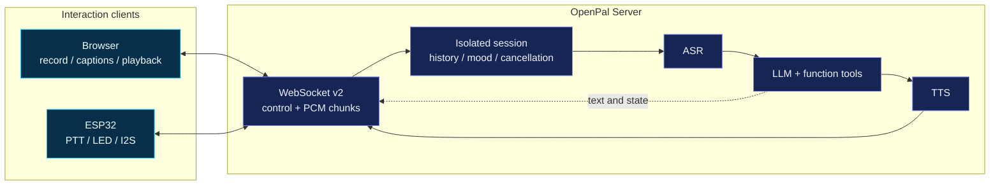
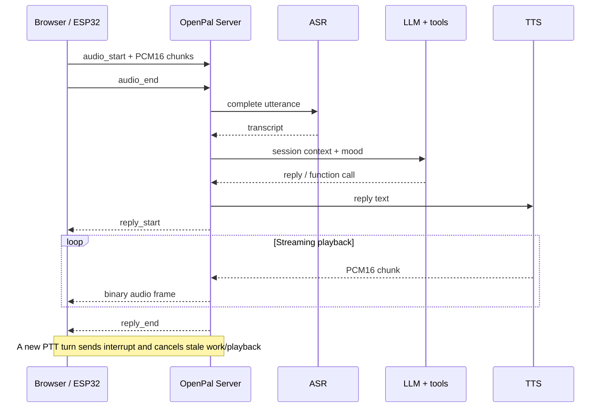

# OpenPal

[](https://docs.espressif.com/projects/esp-idf/)
[](./docs/architecture.md)
[](./server)
[](./server/tests)

OpenPal is a small, self-hosted AI voice terminal. A browser or ESP32 streams
audio to a Python server that connects ASR, an LLM, function tools, and TTS.
It favors readable code, LAN deployment, and explicit capability reporting.
It is not a fork of xiaozhi-esp32.

[中文](./README_zh.md) · [Architecture and protocol](./docs/architecture.md) · [XiaoZhi comparison](./docs/compare-xiaozhi.md)


## System at a glance



| I/O | Session experience | Current boundary |
|:---|:---|:---|
| ✅ Browser and ESP32 clients | ✅ Context isolated per connection | 🧭 Wake word / device VAD |
| ✅ Bidirectional PCM16 streaming | ✅ Inference, synthesis, and playback can be interrupted | 🧭 Opus / jitter buffer |
| ✅ Honest provider readiness | ✅ Mood drives replies and LED state | 🧭 Authentication / OTA / durable memory |

## What works

- Text chat with a zero-key `toy-brain` demo.
- Browser recording when ASR is configured; text still works when it is not.
- Streamed ESP32 push-to-talk input and streamed PCM playback.
- Per-connection history, mood, and cancellable turns—no conversation broadcast.
- A small valence/arousal personality model and OpenAI-compatible function calls.

Wake words, Opus, authentication, OTA, durable memory, and the MCP protocol are
not implemented yet. Do not expose the current server directly to the public Internet.

## Browser quick start

```bash
cd server
python3 -m venv .venv
source .venv/bin/activate
pip install -r requirements.txt
cp .env.example .env
python -m pal_server.main
```

Open <http://localhost:8080>. With the default `PAL_ASR_PROVIDER=disabled`, the
microphone button is disabled honestly; typing still exercises the complete
session, LLM demo, mood, and tool path.

For voice input, configure an OpenAI-compatible Whisper endpoint:

```bash
export PAL_ASR_PROVIDER=openai
export PAL_ASR_API_KEY=sk-...
```

Or set `PAL_ASR_PROVIDER=whisper_local` and install `faster-whisper`. Default
Edge TTS also needs Internet access, the `edge-tts` package, and `ffmpeg`.
`/api/status` and the dashboard report actual provider readiness.

## LLM configuration

```bash
# DeepSeek
export PAL_LLM_BASE_URL=https://api.deepseek.com/v1
export PAL_LLM_API_KEY=sk-xxx
export PAL_LLM_MODEL=deepseek-chat

# Local Ollama
export PAL_LLM_BASE_URL=http://127.0.0.1:11434/v1
export PAL_LLM_API_KEY=ollama
export PAL_LLM_MODEL=qwen2.5:7b
```

The endpoint must support OpenAI Chat Completions. Function calling is used
for time, weather, jokes, arithmetic, volatile notes, and LED commands. This
tool registry is not an MCP implementation.

## ESP32 hardware

The continuously built target is classic ESP32 with ESP-IDF 5.5. Defaults are
configurable under `OpenPal Configuration` in `idf.py menuconfig`.

| Module | Signal | Default GPIO |
|---|---|---:|
| INMP441 | BCLK / WS / SD | 14 / 15 / 32 |
| INMP441 | L/R | GND (left channel) |
| MAX98357A | BCLK / LRC / DIN | 26 / 25 / 22 |
| PTT button | GPIO to GND | 4 |
| Status LED | output | 2 |

All modules must share ground. The microphone uses I2S1 RX with 32-bit slots
at 16 kHz; the amplifier uses independent I2S0 TX and follows each reply's
declared PCM16 sample rate.

```bash
cd firmware
idf.py set-target esp32
idf.py menuconfig       # Wi-Fi, ws://<server-LAN-IP>:8080/ws, and pins
idf.py build
idf.py flash monitor
```

Hold PTT to talk and release to transcribe. Pressing PTT during inference,
synthesis, or playback interrupts the old turn. The default utterance limit is
15 seconds on both device and server.

## Protocol v2

JSON text frames carry control messages. Binary frames carry mono PCM16LE,
normally 16 kHz upstream and 24 kHz downstream. A reply is framed by
`reply_start`, binary chunks, and `reply_end`; it is never embedded as a large
Base64 JSON value. See [architecture.md](./docs/architecture.md).

PCM is deliberately easy to inspect, but costs about 256 kbit/s at 16 kHz.
Opus and a jitter buffer remain roadmap work.



## Verification

```bash
cd server && pytest -q
cd ../firmware && idf.py build
```

## License

MIT
