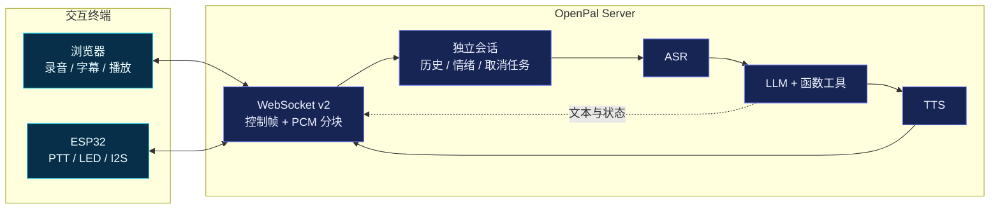
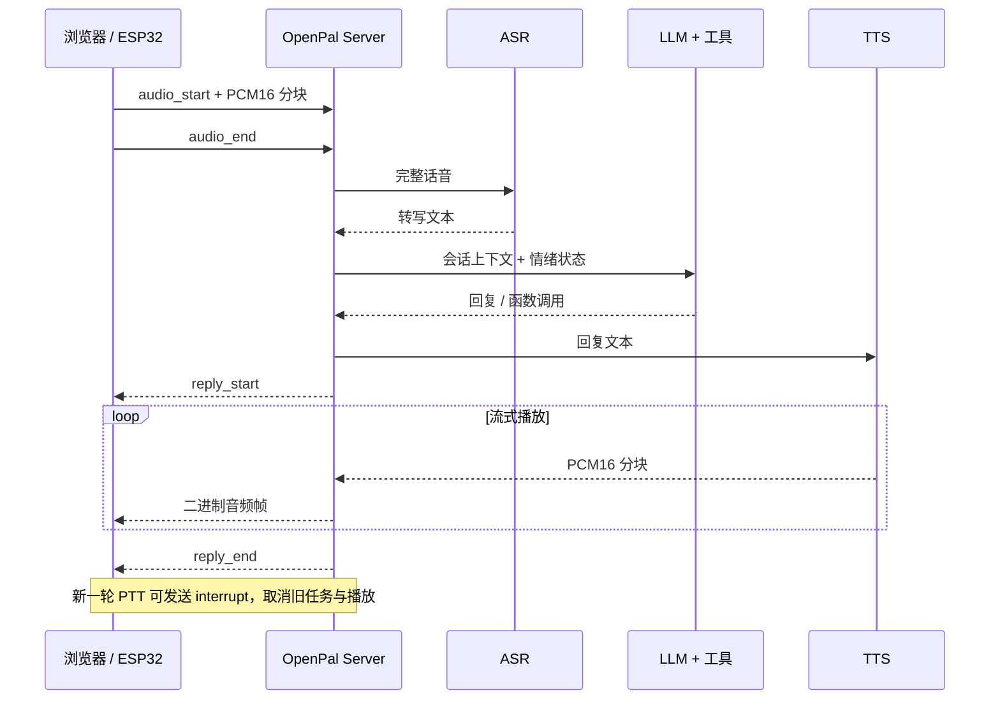

# OpenPal

[](https://docs.espressif.com/projects/esp-idf/)
[](./docs/architecture.md)
[](./server)
[](./server/tests)

OpenPal 是一个小而透明的自托管 AI 语音终端：浏览器或 ESP32 采集语音，Python
服务端串起 ASR、LLM、工具调用和 TTS。项目强调可改造、局域网部署和明确的能力状态，
不是 xiaozhi-esp32 的 fork。

[English](./README.md) · [架构与协议](./docs/architecture.md) · [与小智对比](./docs/compare-xiaozhi.md)


## 系统一览



| 输入与输出 | 会话与体验 | 当前边界 |
|:---|:---|:---|
| ✅ 浏览器与 ESP32 双端 | ✅ 每连接独立上下文 | 🧭 唤醒词 / 设备端 VAD |
| ✅ 双向 PCM16 流式传输 | ✅ 推理、合成、播放可打断 | 🧭 Opus / 抖动缓冲 |
| ✅ 真实能力状态反馈 | ✅ 情绪参数驱动回复与灯效 | 🧭 鉴权 / OTA / 长期记忆 |

## 当前能做什么

- 文本聊天：零 API Key 可运行 `toy-brain` 演示。
- 浏览器语音：配置 ASR 后录音；TTS 可用时播放语音，否则保留文字回复。
- ESP32 PTT：按下边采边发，回复边收边播，不再缓存整段录音或 Base64 大包。
- 会话隔离：每台设备有独立历史、情绪和可取消任务，不会串台。
- 情绪状态：`valence/arousal` 影响提示词、LED 颜色和 TTS 语速。
- 函数调用：时间、天气、笑话、计算、短期笔记和 LED 控制。

尚未实现：唤醒词、Opus、鉴权、OTA、真正的 MCP 协议、长期记忆。请不要把当前版本直接暴露到公网。

## 先跑浏览器版

```bash
cd server
python3 -m venv .venv
source .venv/bin/activate
pip install -r requirements.txt
cp .env.example .env
python -m pal_server.main
```

打开 <http://localhost:8080>。不配置任何 Key 时可以打字体验；默认 `ASR=disabled`，
所以麦克风按钮会明确禁用，而不是录完以后假装识别。

要开启语音输入，可选其一：

```bash
# OpenAI-compatible Whisper API
export PAL_ASR_PROVIDER=openai
export PAL_ASR_API_KEY=sk-...

# 或本地 faster-whisper（需另行安装 faster-whisper）
export PAL_ASR_PROVIDER=whisper_local
```

默认 TTS 使用 `edge-tts`，需要联网并且系统中有 `ffmpeg`。也可在 `.env` 中改为
OpenAI TTS 或 `silent`。状态页会显示真实可用性。

## 接入 LLM

任何兼容 OpenAI Chat Completions 和 function calling 的端点都可以接：

```bash
# DeepSeek
export PAL_LLM_BASE_URL=https://api.deepseek.com/v1
export PAL_LLM_API_KEY=sk-xxx
export PAL_LLM_MODEL=deepseek-chat

# 本地 Ollama
export PAL_LLM_BASE_URL=http://127.0.0.1:11434/v1
export PAL_LLM_API_KEY=ollama
export PAL_LLM_MODEL=qwen2.5:7b
```

## ESP32 真机

当前持续构建目标是经典 ESP32 + ESP-IDF 5.5。默认接线如下，所有引脚均可在
`idf.py menuconfig` 的 `OpenPal Configuration` 中修改：

| 模块 | 信号 | 默认 GPIO |
|---|---|---:|
| INMP441 | SCK / BCLK | 14 |
| INMP441 | WS / LRCL | 15 |
| INMP441 | SD / DIN | 32 |
| INMP441 | L/R | GND（左声道） |
| MAX98357A | BCLK | 26 |
| MAX98357A | LRC / WS | 25 |
| MAX98357A | DIN | 22 |
| PTT 按键 | GPIO ↔ GND | 4 |
| 状态 LED | 输出 | 2 |

麦克风与功放必须共地。INMP441 使用 I2S1 RX（32-bit slot / 16 kHz），MAX98357A
使用 I2S0 TX（PCM16，按服务端声明动态切换采样率）。分开时钟能避免输入、输出格式
和采样率互相污染。

```bash
cd firmware
idf.py set-target esp32
idf.py menuconfig       # 配 Wi-Fi、ws://<电脑局域网 IP>:8080/ws 和引脚
idf.py build
idf.py flash monitor
```

按住 PTT 说话，松开后识别。回复播放、推理或合成期间再次按下 PTT 会打断当前轮次。
默认单次最多 15 秒，设备与服务端都会做上限检查。

## 协议 v2

一条连接中混合两类帧：

- JSON 文本帧：`audio_start`、`audio_end`、状态、字幕、错误等控制信息。
- 二进制帧：单声道 PCM16LE 音频块，上行默认 16 kHz，下行通常 24 kHz。

回复由 `reply_start`、若干二进制帧、`reply_end` 包围。详见
[架构与协议](./docs/architecture.md)。PCM 的好处是实现简单、容易调试；代价是单向
16 kHz 音频约 256 kbit/s，Opus 仍在路线图中。



## 内置函数工具

`tools.py` 目前实现的是 OpenAI-compatible function calling，不是 MCP：

| 工具 | 示例 |
|---|---|
| `get_time` | “现在几点？” |
| `get_weather` | “北京天气？” |
| `get_joke` | “讲个笑话” |
| `compute` | “12*13” |
| `remember` / `recall` | “记住买牛奶” |
| `control_led` | “开灯” |

其中笔记只存在进程内存中，天气查询会访问 `wttr.in`。

## 验证

```bash
cd server
pytest -q

cd ../firmware
idf.py build
```

## 路线图

- [x] 会话隔离、可取消任务、双向 PCM 分块
- [x] ESP32 流式采集/播放与采样率切换
- [x] 浏览器重采样和运行时能力提示
- [ ] Opus 与抖动缓冲
- [ ] 唤醒词 / 设备端 VAD
- [ ] 鉴权、设备身份与限流
- [ ] 标准 MCP client/server 集成
- [ ] OTA、屏幕表情和 Home Assistant

## License

MIT
